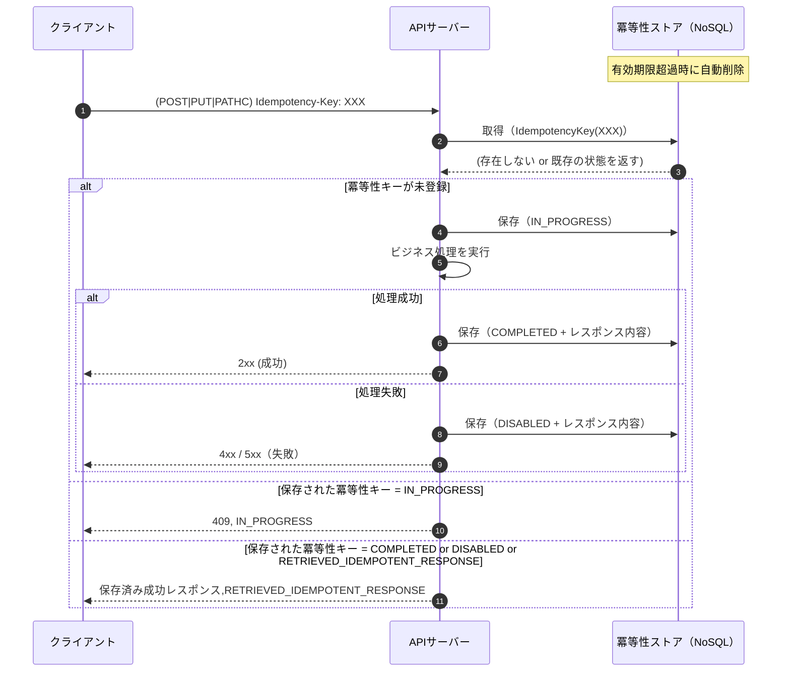

## 冪等性とは

> 冪等性（べきとうせい）とは、同一リクエストを複数回実行してもリソースの状態および外部副作用が一度だけ実行された結果と同一になること。

| メソッド | 冪等性                     | 説明                                                                          |
| -------- | -------------------------- | ----------------------------------------------------------------------------- |
| GET      | 冪等                       | 副作用を持たせてはならない（MUST）（もし冪等キーが必要ならAPIを改善するべき） |
| POST     | 非冪等                     | 重複作成などの危険あり                                                        |
| PUT      | 基本的に冪等               | 何度実行しても完全にリソースを置き換え（冪等）。                              |
| PATCH    | 基本的に冪等だが場合による | 単に属性更新など（冪等）。状態変更で新規にリソースが作成される場合は非冪等    |
| DELETE   | 冪等                       | 削除以外に使用しない                                                          |

:::warning
PATHC で単にリソースの属性を変えるだけであれば冪等だが（名前を太郎→二郎）、以下のようなケースは非冪等。

- インクリメントする場合（+10ポイントするなど）
- スイッチのような動作をする場合（一時停止・再開）
- ステータス遷移によって新しくリソースが作られる場合（売上を確定させることで確定済みレコードが作られるなど）
- 変更通知の送信（状態の変更時にメール通知を送信する、Webhook通知）
- リソースの状態（DB状態）が変わらなくても外部連携、イベント発行がある場合

:::

---

## 動作

- 冪等性キーが存在しなければリソースを新規に作成
- 冪等性キーがあれば保存されているレスポンス（以前と同様）を返す
- 仕掛中であれば、`409 Conflict` を返す
- 同一の冪等性キーだが異なるAPIに（冪等性キー使いまわし）、 `422 Unprocessable Content` を返す
- レスポンスヘッダーで `Idempotency-Status` を返す
- 冪等性キーは有効期限切れた場合に削除される（TTL）

---

## ステータス（`Idempotency-Status`）

| 状態                          | 意味                                                         | クライアント応答     | 返却情報                 |
| ----------------------------- | ------------------------------------------------------------ | -------------------- | ------------------------ |
| IN_PROGRESS                   | サーバーで処理中。二重リクエストを防ぐためロック相当の状態。 | `409 Conflict`       | 処理せずに返す           |
| COMPLETED                     | 処理完了済み。                                               | 成功レスポンス       | 処理した結果             |
| DISABLED                      | エラーで終了済み。                                           | エラーレスポンス     | 処理した結果             |
| RETRIEVED_IDEMPOTENT_RESPONSE | 過去に返却済みのレスポンスを再取得した状態。                 | 成功またはエラー応答 | 処理済みの保存された結果 |

- レスポンスのヘッダーに`Idempotency-Status`を設定する
- ハンドリングに使用しても構わないが、ハンドリングのためではなく、ログや実装・試験用途
- 返却済み冪等レスポンス（RETRIEVED_IDEMPOTENT_RESPONSE）は、リクエストは実際には処理されず、指定した冪等性キーとして保存されているレスポンスを返したことを保証する状態
- 冪等キーが使いまわされて（冪等キーの重複）`422 Unprocessable Content`を返す場合には`Idempotency-Status`は未設定

---

## ルール

- 原則的に、フロントが、`Idempotency-Status`でハンドリングする想定はなく、ステータスコードでハンドリングする想定
  - `409 Conflict`は処理中。待ってから再送、諦めるなど
  - `422 Unprocessable Content`はバグの可能性大
- 4xx、5xxのどちらでもレスポンスを保存する
- 返却済み冪等レスポンスが戻されたことが判明しているのであれば同じ冪等キーで再送してはならない（繰り返し実行して結果が変わること期待してはいけない）
- サーバーは、連続打鍵を受けた際の負荷を軽減するために5xxでも返却済み冪等レスポンスとする
- クライエントは、5xx発生時で、単にレスポンスが得られずに再送するなら返却済み冪等レスポンスで問題ないが、5xxで意図的に再送したい場合は、異なる冪等キーを設定する必要があり
- `422 Unprocessable Content`が返却された場合は冪等キーを再作成しなければならない
- 同一冪等性キーでリクエストボディが異なる場合は`422 Unprocessable Content`にはならない
- `422 Unprocessable Content`は「同一冪等性キーか」「同一パスか」で判定（同一冪等性キー、異なるパスで発生）
