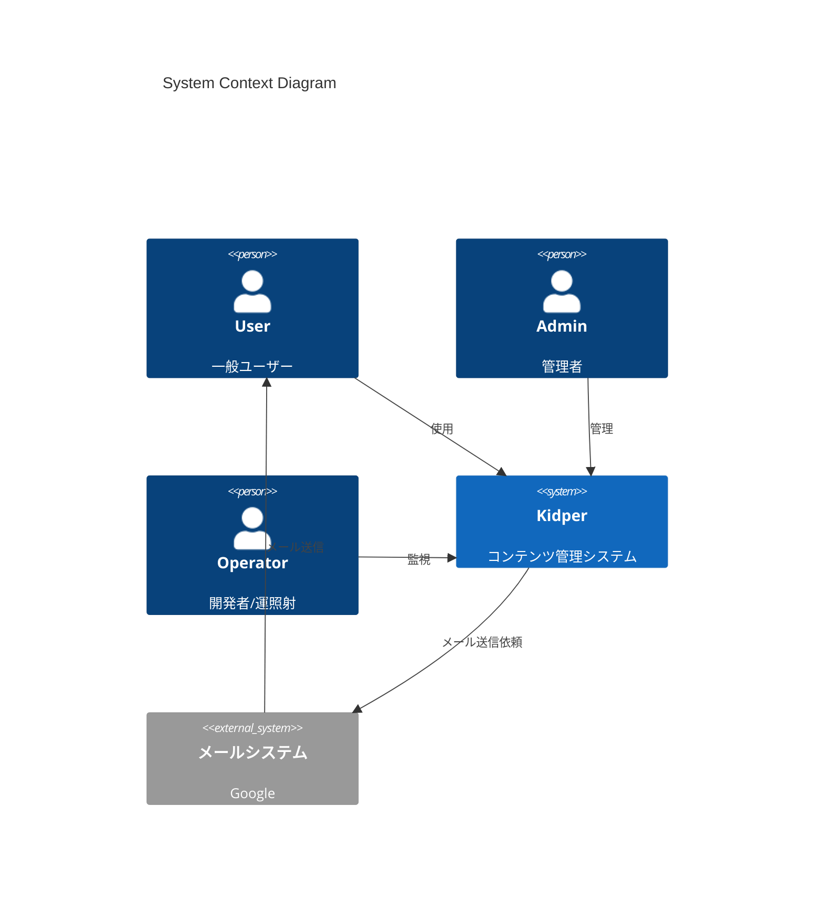
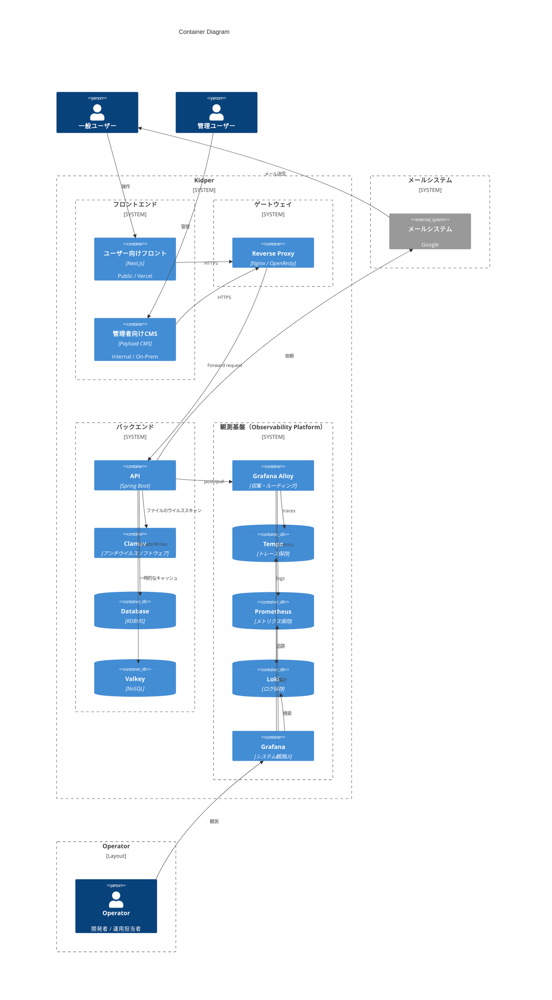

ソフトウェアアーキテクチャ図を C4モデル の コンテキストとコンテナレベルを記載を示す。

※ コンポーネントレベルは、記載しない。代わりにarchitectureを参照すること
※ コードレベルは記載しない。代わりにドメインを参照すること

## C4 図

> C4モデルとは、異なる抽象レベルでソフトウェアアーキテクチャを視覚化する方法を提供する。以下の4つのレベルの図で構成されている。

- コンテキスト(Context)
- コンテナ(Container)
- コンポーネント(Component)
- コード(Code)

## システムコンテキスト図

> 自身のソフトウェアシステム と それを使用する人 や 関連する他システム との 相互作用を描くレベル。

**目的**

- システムの責務範囲を明確にする
- 利用者（User / Admin / Operator）の関与を整理する
- 外部システムとの依存関係を把握する

**注意**

- 内部構造や技術スタックは記載しない
- 実装やデプロイ構成の詳細は後続のコンテナ図で扱う

**Diagram**

---

## コンテナ図

> システムを構成する「コンテナ」（アプリケーションの実行単位）の関係を描くレベル。
> 「どのプロセス・サービスが何を担当するか」を示す。

**目的**

- システムの 内部構造を理解 する
- どのコンテナが何を担当しているかを明確化
- 通信経路と 依存関係 を可視化

**注意**

- インフラの構成図にしたくなるが、インフラ構成ではなく、「役割」（責務）で境界を分けること
- 各コンテナの内部実装は記載しない
- コンテナはdockerのコンテナとは異なる

**Diagram**

