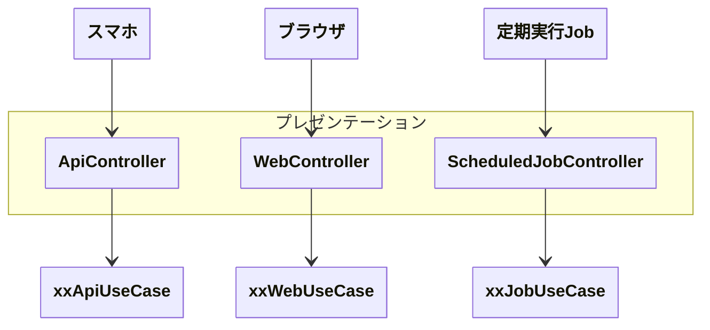

## 概要

> プレゼンテーション層は「何をするか」ではなく、「どのように外部と接続するか」に責任を持つ。

クライエントとアプリケーションの**入出力**を実現する。
つまり、インターフェースの役割を担う。
インターフェースの種類は、API、HTML、定期実行スケジューラー、CLIなどがある。

プレゼンテーションは、業務処理は行わず、**入出力** に徹し、
外部 と **業務処理を行うユースケース層 の橋渡し**を行う。

誤って業務ロジックを記載してしまわないように注意が必要。

今行おうとしている設計や実装は、「外部へ入出力としての関心ごとか？」を問うこと。

## 責務

- ヘッダーやクエリの変換
- リクエスト・レスポンスの変換
- JSONなどの定義やHTMLの生成はユースケースの責務
- 表示用のためのフォーマット処理（金額 10 → 10円）
- fieldsの絞り込み
- 冪等性キーなど入出力の技術的な関心ごと
- 例外をキャッチして、エラーレスポンスを返す
- 認証・認可（JWTなど、認証はプレゼンテーション、認可はユースケースでもよい）
- バリデーション

---

## 責務違反

- 業務ルールを伴う値オブジェクトを生成する（ただし、xxIDは例外とする）
- 業務ロジックを記載する
- データベースへ直接アクセスする（キャッシュとして捉えられるNoSQLは例外）
- ユースケースの中で HTTP や JSON を意識させること
- ユースケース内で HTML を生成させること

---

## 注意・ルール

---
