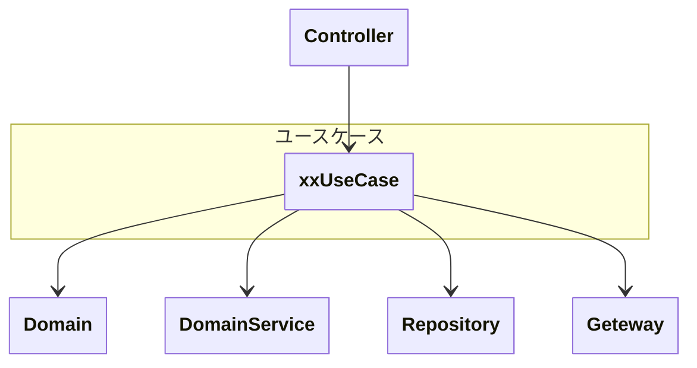

## 概要

> ユースケースは、「ユーザーの目的（ユースケース）」を達成するための手順を調整する（オーケストレーション）

ユースケースは、ビジネスルールの中心は持たず、ドメインモデルに振る舞いを委譲しながら、
ドメインモデルやドメインサービスを **組み合わせて、ユースケース（ユーザーが実現したい、利用したいサービス）** を提供する。

**手順の調整** に徹し、ビジネスルールはドメイン層に任せる。

また、ユースケースは「 **何を実現するか** 」に責任を持ち、「どのように永続化するか」や「どのように通信するか」には責任を持たない（インフラストラクチャーに委譲）。

「ユースケース層」と呼んでいるが、「アプリケーションサービス層」とも呼ばれる。

「このアプリケーションはどんなアプリなのか？」に対する答えであり、
アプリケーションとして提供する機能の集合体であるため、アプリケーションサービスとも呼ばれる。
アプリケーションサービスでは、感覚的に捉えづらかったり、ドメインサービスと混同するため ユースケースと呼んでいる。

---

## 責務

- 値オブジェクトやエンティティの生成をトリガーする（コンストラクタ、ファクトリの呼び出し）
- ドメインサービスの呼び出し
- リポジトリのメソッドを呼び出して永続化・再構成を行う
- トランザクション境界を定義する
- ドメインを組み合わせたオーケストレーション
- 権限確認・認可制約のチェック
- 外部システムとの調整（具体的な接続は行わない）

---

## 責務違反

- リポジトリの具体的な実装（SQLの実行）
- ドメインロジックの記述
- オブジェクトが常に満たすべき状態（不変条件）のチェック
- 認証を行う
- 外部システムとの接続

---

## 注意・ルール

- 1ユースケース = 1クラス
- パブリックメソッドは1つのみ持つ（execute）
- プレゼンテーション層に依存しない（HTTP・JSONを知らない）
- 具体的なインフラ実装に依存しない（インターフェースに依存する）
- ユースケース同士は直接呼び出さない
- 返却値はDTOとする（ドメインオブジェクトをそのまま返さない）
