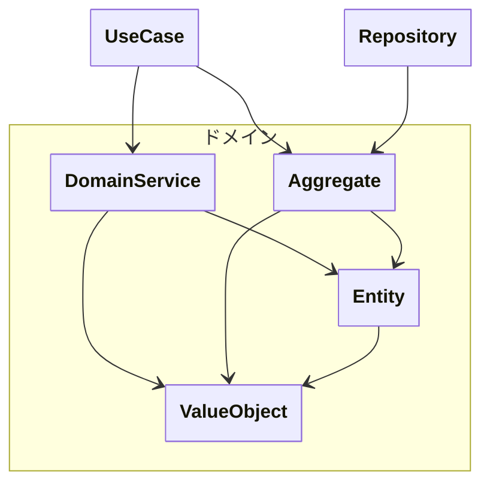

## 概要

> ドメイン層は、アプリケーションの「正しさ」を保証する層である。

ドメイン層は、**アプリケーションの中核** となる層であり、
**ビジネスルールと概念そのものを表現** する。

外部技術（HTTP・DB・フレームワーク）を知らず、
「 **業務的に正しい状態とは何か** 」「 **どう振る舞うべきか** 」だけに関心を持つ。

ドメイン層は、**アプリケーションの正しさを保証する層** である。

## 責務

- エンティティの定義
- 値オブジェクトの定義
- 集約の整合性の維持
- ドメインサービスの定義
- 不変条件（常に満たすべき状態）の保証
- ビジネスルールの実装

---

## 責務違反

- SQLの実行
- JSONの生成
- トランザクション制御
- 認証処理
- 外部API呼び出し
- 画面表示ロジック
- DTOの生成
- プレゼンテーション用の整形処理

---

## 注意・ルール

- 永続化の方法を知らない
- HTTPやJSONを知らない
- フレームワークに依存しない
- 単体でテスト可能である
- ドメインサービスはできるだけ作成しない
- 集約ルート以外を外部に公開しない

---
