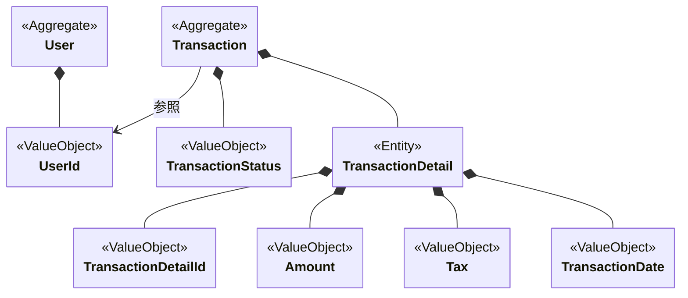

## 集約（Aggregate）とは

> 守るべき不変条件を持つオブジェクトのまとまり

- 強い整合性が必要な境界
- トランザクションの単位
- 保存・更新・削除は集約単位で行う

「 **守りたい整合性を持ったオブジェクトのまとまり** 」を表す。
ドメインオブジェクト同士（エンディティや値オブジェクト）の整合性を維持する最小単位（ **トランザクションの単位** ）。
集約は、オブジェクトのライフサイクルを共にする。集約の単位で保存・更新・削除する。

集約は「**変更の一貫性**」を守るための境界である。
ドメインオブジェクト同士の「**整合性を守る**」ことを意識する。
集約は、ビジネス上のルール（不変条件）が常に満たされるよう集約内のバリューオブジェクトやエンティティの内部状態を守る（**整合性を守る**）。

とにかく「**整合性を守る**」を意識して設計する。

## 集約ルートとは

> 集約への唯一のアクセスポイント（窓口）

- 外部はルート経由でのみ操作する
- 内部エンティティを直接変更してはいけない
- 不変条件は常にルートが保証する

集約ルートをもとにプロパティの更新を行い、値をオブジェクトやエンティティを直接操作してはいけない。

集約ルートとは、集約内のエンティティやバリューオブジェクトが外部から直接操作してはいけない。必ず集約ルートを経由して操作する。

> 例:
> ユーザー、取引、注文

---

## 必ず守ってほしいこと

- 強い整合性確保が必要なものを1つの集約とする
- トランザクションを必ず1つにする（正確には、1つのトランザクションで整合性を保証すべき範囲を1集約とする）

### 注意・コメント

- 集約と集約同士は識別子（xxId）を参照する
- ドメインモデル（事業）を元に設計する。どうしてもTBlを元に考えたくなるが、ドメインモデル（事業を）を元に考えること。
- データモデルベースで考えるとトランザクションスクリプトになってしまう。データモデルの知識がドメインモデルに漏れ出してしまい、ドメインモデルが壊れていく。**DBは忘れること**が重要
- エンティティや値オブジェクト間の強い整合性（守るべきルール）をベースに考える。
- 集約の境界は、かなり悩ましいところ。正解がなく実装してから違和感を抱くことも多い。集約の境界は、実装してみないわからないことも多いいため、ソースとして書いてみて違和感があれば修正する。
- なるべく小さい方がいい（適切な大きさ）。トランザクションの単位であるため大きいと更新範囲も広くなり、ロックの範囲も広くなる。
