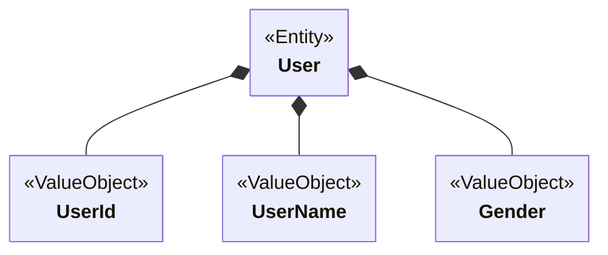

## エンティティ（Entity）とは

> 「データの入れ物」ではなく、「振る舞いを持つ存在」である。
> 同一性（Identity）で区別される

必ず**識別子（xxId）**を持ち、識別子によって**同一性が識別できる**ドメインオブジェクト。
必要な制約や振る舞いを持つ。

例えば、ユーザーなどは、名前や住所などの属性がすべて同じであっても、IDが異なれば「別の存在」として扱われる。
属性を変更しても識別子が同じ存在として扱われる（同一性）がエンティティである。

同一性を維持したまま状態が変化する**可変（Mutable）**なオブジェクト。

エンティティは生成・更新・削除というライフサイクルを持つ。
その存在が終了（削除）すれば、内部状態（属性）も共に消滅する。

識別子（xxId）を持ち、識別子によって区別されるかどうかで値オブジェクトと区別される。
（値オブジェクトとの違いは「識別子の有無」ではなく、**同一性で区別されるか**どうかである）

> 例: ユーザー、社員、取引明細、注文明細

---

## 必ず守ってほしいこと

- 同一性を明確に定義する
- **識別子（xxId）は値オブジェクト**として定義する
- 不変条件はエンティティ自身が保証する
- 外部から直接状態を書き換えさせない

### 注意・コメント

- コンストラクタやファクトリメソッドで不正な状態を守る
- エンティティは識別子のみで比較する
- エンティティをDTOとして使わない
- DBのエンティティとは異なる概念
- 集約ルートはエンティティである
- 可変な値は最小限にする
- 不必要に値を公開しない
- コレクションは直接公開せず操作を公開する
