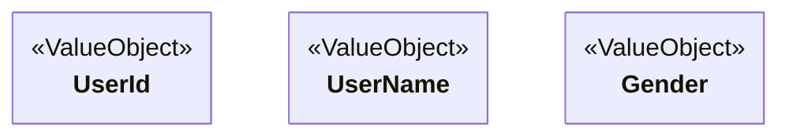

## 値オブジェクト（ValueObject）とは

> 単なる数値や文字列（プリミティブ型）としてではなく、
> **業務上の意味・制約・振る舞いを持つドメインオブジェクトとして表現したもの。**

値オブジェクトは「 **意味のある型** 」である。

値オブジェクトに**値に関する振る舞い**を持たせ、**その業務としての意味を持つ値であること**が重要である。

業務特有の値は、可能な限り値オブジェクトとして型を定義する。
なんでもかんでもプリミティブ型を使ってはならない（ただし、プリミティブの使用を全面禁止するわけではない）。

値オブジェクトは生成したらその値を変更することができない不変性（Immutable）をもつ。
変更したい場合は新しくインスタンスを生成して交換することによって、状態変更は行わずに置き換えることはできる（交換可能）。

同一かどうかは値そのそもを比較することで行う。

生成する際には不正な値として生成できないように制約のチェックを行なってから生成することで、不正な値が作れるのを防ぐ。

例えば、ユーザー名の文字数が1000文字や1万文字もあるような長い名前を持った人はまずいないが、
1000文字の太郎さんをプリミティブな値では生成できてしまう。
しかし、ユーザー名を値オブジェクトとして定義し、文字数30文字までと制約を設ければ、
生成された時点で必ず業務の制約に沿った値を生成できる（不正な値を生成させない）。

また、メソッドの引数なども値オブジェクトを用いて型指定することで、
誤って関係ない値を引数に設定して呼び出すことも抑制できる。

> 例: 金額、xx日付、注文数、電話番号

---

## なぜ必要か

- 不正な値の生成を防ぐ
- 業務ルールを一箇所に閉じ込める
- 型によって誤使用を防ぐ
- コードが自己文書化される
- 不変性により安全性が高まる

---

## 必ず守ってほしいこと

- 不正な値の生成をさせない（コンストラクタやファクトリで制約チェックを行う）
- 不変であること
- 置き換え可能（置き換えによって状態変更を表現）
- 値による同一性判定（値によって比較可能）
- 値に関する振る舞いを持たせる

### 注意・コメント

- 基本的に識別子を持たない
- エンティティと異なり識別子で比較しないで値そもので比較する
- 値に関する振る舞いを持つべき
- 外部状態に依存しない
- 外部のドメインに引っ張られてドメインのモデルを作ってはいけない
- DBアクセスしない
- 1つの概念を表す（小さく保つ）
- 責務を肥大化させない
