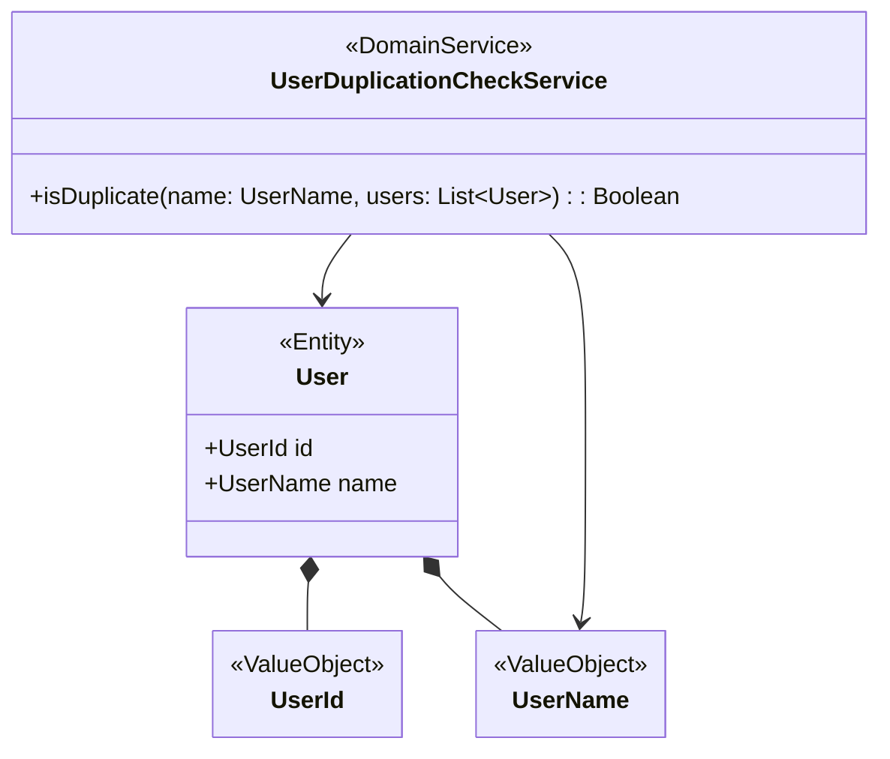

## ドメインサービス（DomainService）とは

> 業務上の意味・制約・振る舞いをできるだけエンティティや値オブジェクトで表現するが、
> **エンティティや値オブジェクトでは自然に表現できないビジネスロジック**を持つサービスのこと

あくまで、**エンティティや値オブジェクトで表現することを前提する**が、
エンティティや値オブジェクトで表現するのが不自然な場合にドメインサービスを使用する。

「値」でも「モノ」ではなく、「アクション（操作）」を表現する。
例えば、複数のオブジェクトをまたぐ計算や検証、自身の状態を持たない純粋なロジック。

ドメイン固有のルールを実現するのがドメインサービスであり、永続化やユースケースを持つものではない。

ドメインサービスで最も意識するべきことは、「 **使いすぎ厳禁** 」である。
何でもドメインサービスに書くと、エンティティが「データを持つだけ（ドメインモデル貧血症）」の表現力を失ったモデルになってしまい、
単なるスクリプトとなってしまう。

| 種類                                     | 役割                   |
| ---------------------------------------- | ---------------------- |
| ドメインサービス                         | 業務ルール             |
| アプリケーションサービス（ユースケース） | ユースケースの手順制御 |

> 例: ファクトリー、リゾルバー、OTP検証、値の重複チェック、暗号化するサービス

---

## なぜ必要か

- 複数エンティティにまたがるルールを表現する
- どのエンティティにも属さない振る舞いを表現する
- ドメインロジックをアプリケーション層へ漏らさない
- 業務ルールをドメイン層に閉じ込める

---

## 必ず守ってほしいこと

- 使いすぎない。一旦、エンティティや値オブジェクトで表現できないか考えてから実装する
- 状態を持たないこと（インスタンス変数を持たないがメソッド内で変数を持つことは可）

### 注意・コメント

- ユースケース固有の手順を書くものではない
- 永続化を行う実装を書いてはいけない
- 外部サービスとの接続はしない
- スクリプト化した神クラスをつくらない
- 単に属性を変更するだけであればドメインサービスを使用しないでエンティティに実装を書く
