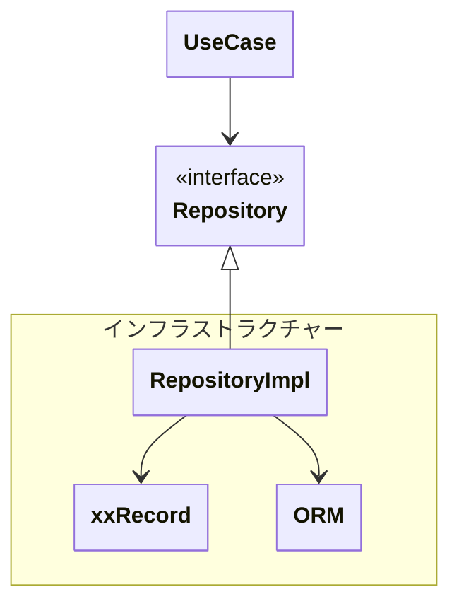

## 概要

> インフラストラクチャ層は、ドメインモデルを現実世界の技術基盤（DB・外部API・メッセージングなど）へ接続するための実装層である。
> ビジネスロジック（ドメイン）とは切り離された「 **技術的な詳細** 」を担う

外部とアプリケーションの入出力を実現する。
ドメインが「常務上の知識（ドメイン）や業務上の関心ごと」であるのに対して、
インフラストラクチャーは「 **技術的な関心ごと** 」である。

### 主なサービス

| サービス       | 説明                     | 主目的           |
| -------------- | ------------------------ | ---------------- |
| リポジトリ     | ドメインの永続化・再構成 | 更新系           |
| クエリサービス | 表示のためのデータ取得   | 参照系           |
| ゲートウェイ   | 外部通信                 | 外部の更新・参照 |

### 各サービスの対比

| 項目     | リポジトリ | クエリサービス | ゲートウェイ            |
| -------- | ---------- | -------------- | ----------------------- |
| 主な対象 | 内部DB     | 内部DB         | 外部システム            |
| 主な用途 | 書き込み   | 読み取り       | 読み取り or 書き込み    |
| 単位     | 集約単位   | 表示最適化     | 外部APIサービス（1API） |
| 返却     | ドメイン   | DTO            | ドメイン or DTO         |

## 責務

- 技術的詳細の隠蔽（SQLの実行、外部API実行）
- データの永続化
- 外部サービスとの連携（外部API連携）
- 技術的な共通機能（メール送信機能など）
- 上位層（ユースケース・ドメイン）はインフラに依存しない
- インフラはドメインに依存する

---

## 責務違反

- ビジネスルールの実装
- トランザクション境界の決定（ユースケースの責務）

---

## 注意・ルール

- ドメインモデルを汚染させない
- フロントからの入出力を扱わない（プレゼンテーション層）

---
