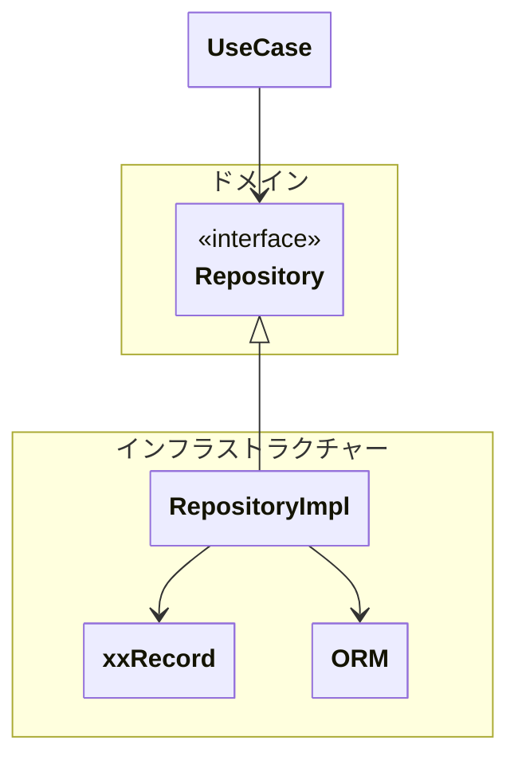

## リポジトリ（Repository）とは

> 集約の永続化および再構成を担う抽象的なインターフェース

集約の単位でまるで**コレクション（リスト）**のように**永続化・再構成**を行う**抽象的な窓口**。

**集約の保存・取得・削除**を行う。更新は再構成した集約内で状態変更した後に、変更前の集約を削除し更新後の集約を保存することで更新を行うことを基本とする。性能上の問題が発生した場合や識別子を連番で採番しており、識別子が変更できない場合には更新することも可。

集約の単位で操作するため、集約内の特定の値オブジェクトやエンティティのみを渡して追加・削除はできない。**必ず集約の単位での操作**になることに留意。

同様に、集約を再構成（取得）する場合は、そのままの集約を取得する。集約の一部の属性のみを取得することは原則できない。ドメインロジックで利用する場合は、原則として**集約全体を再構成**する。

集約を跨いだ取得もできない。あくまでドメインオブジェクトの再構成のみである。
集約を跨いで取得したなる場合はある。ビューモデルとしての取得はリポジトリの責務ではない（クエリサービスを利用すること）。

「リポジトリ = DB操作」と誤解する場合は多いが、リポジトリは永続化を抽象化したものであり、
リポジトリの先はDBやストレージやS3などの場合があり得る。

トランザクション境界はユースケース層で定義され、リポジトリはその中で利用される。

---

## なぜ必要か

- ドメインオブジェクトの永続化、再構成を行うため

---

## 必ず守ってほしいこと

- 集約の単位で操作する
- インターフェースを用意してインターフェースはドメイン層に置く
- DBを意識させない

---

### 注意・コメント

- 集約の単位を必ず守ること
- 保存は集約を渡す
- 取得・削除は識別子などの特定の値オブジェクトのみ渡す
- 更新は、削除と保存を組み回せて更新するのを基本とする
- 存在確認メソッドを追加するのは可能（exists）
- 件数カウントは可能（count）

---
