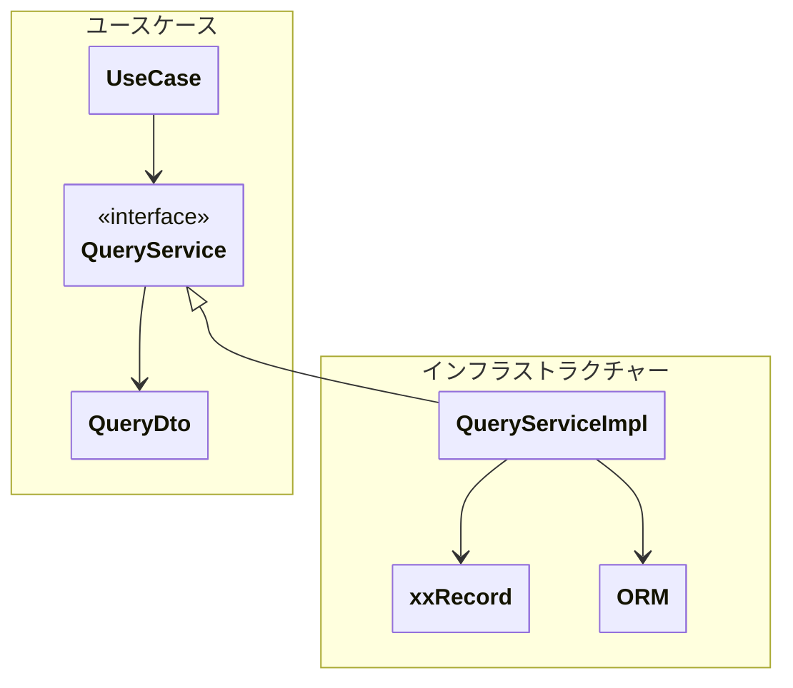

## クエリサービス（QueryService）

> 書き込みモデル（ドメイン）を汚さずに、**読み取り最適化されたデータ取得（参照系）**を行うためのサービス

リポジトリは、集約の単位での取得はできたが、集約をまたぐような広範囲な取得はできないが、表示用のデータを広範囲に取得したいニーズが発生する。この時にリポジトリに実装した場合、リポジトリの責務外の実装が乱立して肥大したリポジトリができてしまう。

**業務ロジックとは関係のない（ビジネスルールを実装しない）表示用のデータ取得**を行うために用意するのがクエリサービスである。
これによりドメイン層の汚染を抑制する。

1クエリーサービスが複数のユースケースで使用されることは原則禁止する（再利用よりも変更影響を局所化）。
ただし、1ユースケースが複数のクエリサービスを呼ぶことは許可。
もし複数のユースケースで呼びたい場合はそれぞれのユースケースでそれぞれクエリサービスを作成すること。

クエリサービスはドメインオブジェクトを返さず、表示用のDTOを直接返す。
クエリサービスは、原則的に、ドメインオブジェクトを使わない（基本的にプリミティブ型で定義されたDTOが返される）。
ただし、例外として識別子（xxID）の利用、列挙子で定義された値オブジェクトは変換のために利用することは可。

## なぜ必要か

- 表示用のデータを取得するため
- 無関係な表示用のデータ取得がリポジトリに実装されるのを防ぐ（ドメイン層の汚染）

---

## 必ず守ってほしいこと

- そのユースケースのためにクエリサービスを作成する
- 1クエリサービスを複数ユースケースで呼んではいけない
- 参照専用（**更新してはいけない**）。
- DTOを直接返す
- ビジネスルールの実装はしない

---

### 注意・コメント

- 必要なデータを必要な分だけ返すこと
- データの取得に徹し、表示のためのフォーマット変換は責務外

---
