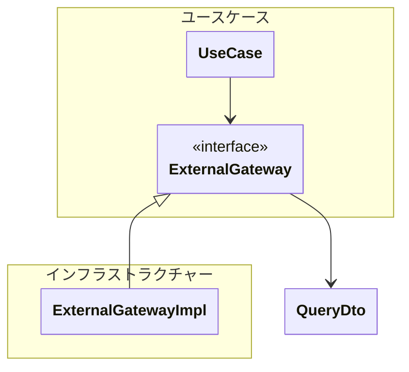

## 外部接続ゲートウェイ（ExternalGateway）とは

> 外部APIや決済サービス、メッセージキューなどの通信を専門に担い、外部サービスの呼び出しを抽象化したサービス。

**ネットワークの向こう側にあるシステム**に対する更新や参照を行う。

原則、「**1ゲートウェイ = 外部接続（API）**」とする。ただし、認証系APIを実行して本来実施したい外部APIを実施する場合などで、技術的な意味合いでまとめる必要がある場合は「1ゲートウェイ = 外部接続（API）x n」とするのは許可。

呼び出し側が通常のメソッドを呼ぶ出すように使用できるようにインターフェースを作成し、外部サービスを隠蔽すること。

**外部の型（外部のドメイン）に内部のドメインが引っ張られてしまわないように注意**する。外部ドメインに引っ張られて、誤ったドメインを設計してしまいたくなるが、内部のドメインが業務に沿っていない形になって壊れてしまうことがある。
外部API、外部SDKが提供する型をそのままアプリケーション層に返してはいけない。外部の型をそのまま返さず、ドメインロジックに関わる場合は自分のドメインモデルに変換して、参照用途の場合は、DTOに変換して返す。

---

## なぜ必要か

- プロトコルの隠蔽（HTTP/REST、gRPC、SOAPなど）
- 外部サービスを意識させない
- インターフェースを用意してインターフェースはドメイン層に置く

---

## 必ず守ってほしいこと

- インターフェースを用意する
- ドメインに属する概念の場合はインターフェースはドメイン層に置く
- 純粋な技術的連携（キャッシュや認可など）の場合はインターフェースはユースケースに置く
- 業務ロジックを置かない
- 外部の型を入れない、外部のドメインに内部のドメインが引っ張られないように

---

### 注意・コメント

- 最も注意するべきは外部に引っ張られて内部ドメインの破壊を抑制すること
- 原則、1ゲートウェイ = 1外部接続（API）

---
