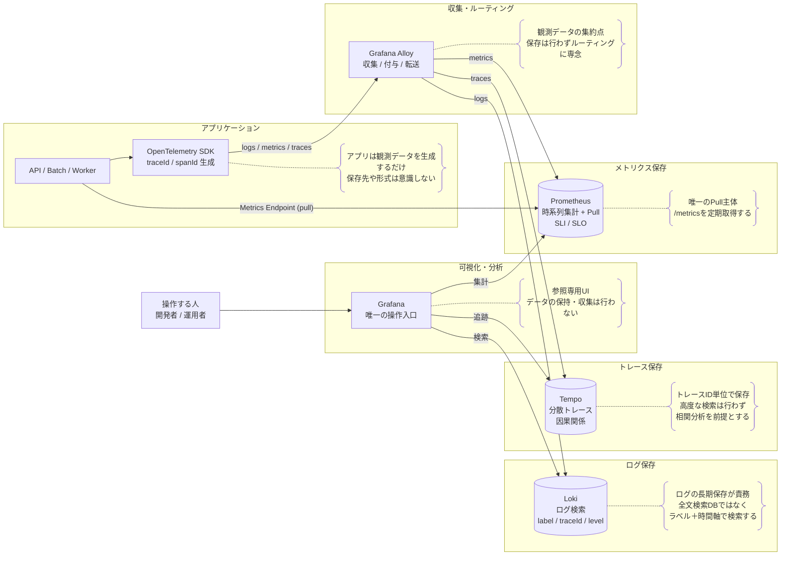

# 観測基盤（Observability Platform）設計書

Grafana Labs 公式推奨構成 / 最新構成

---

## 概要

本設計書は、アプリケーションのログ・メトリクス・トレースを統合的に可視化・分析するための  
最新かつ将来互換性の高い Observability 基盤の設計を示す。

Grafana Labs が推奨する OSS 群を用い、  
ベンダーロックインを避け、責務分離された構成を採用する。

---

## 採用コンポーネント一覧

| 種別             | コンポーネント    |
| ---------------- | ----------------- |
| 可視化 / UI      | Grafana           |
| 収集エージェント | Grafana Alloy     |
| ログ保存         | Loki              |
| メトリクス保存   | Prometheus        |
| トレース保存     | Tempo             |
| アプリ計測       | OpenTelemetry SDK |
| 操作者           | 開発者 / 運用者   |

---

## システム構成図

---

## 各アプリケーションの説明と責務

### Application（API / Batch 等）

**説明**  
業務ロジックを実装するアプリケーション。  
API、バッチ、ワーカー等を含む。

**責務**

- 業務処理の実行
- 観測データ（ログ・メトリクス・トレース）の生成
- traceId / spanId を処理全体で維持
- 可観測性を壊さないログ設計

**非責務**

- ログの収集・転送
- メトリクス・トレースの保存
- 可視化

---

### OpenTelemetry SDK

**説明**  
アプリケーションから観測データを出力するための標準規格および SDK。

**責務**

- traceId / spanId の自動生成と伝播
- ログ・メトリクス・トレースの文脈統一
- フレームワークやライブラリ境界の自動計測

**非責務**

- データの保存
- 可視化
- 運用・分析判断

---

### Grafana Alloy

**説明**  
観測データを収集・加工・転送する統合エージェント。

**責務**

- ログ・メトリクス・トレースの収集
- ラベル付与・フィルタリング・ルーティング
- 各保存基盤（Loki / Prometheus / Tempo）への転送

**非責務**

- データの長期保存
- クエリ処理
- UI 提供

---

### Loki（ログ保存）

**説明**  
ログ専用の保存・検索基盤。

**責務**

- ログデータの永続化
- traceId / level / service 等による検索
- ログ調査の一次入口の提供

**非責務**

- メトリクス集計
- トレース構造の可視化
- ログ生成・収集

---

### Prometheus（メトリクス保存）

**説明**  
時系列メトリクス専用の保存・集計基盤。

**責務**

- メトリクスの保存
- 集計・演算（PromQL）
- SLI / SLO 算出の基盤提供

**非責務**

- ログ保存
- トレース保存
- UI 提供

---

### Tempo（トレース保存）

**説明**  
分散トレーシング専用の保存基盤。

**責務**

- traceId をキーとしたトレース保存
- Span の親子関係の保持
- トランザクション全体の再現

**非責務**

- ログ検索
- メトリクス集計
- トレース全文検索

---

### Grafana（UI）

**説明**  
Observability データを統合的に可視化する UI。

**責務**

- ログ・メトリクス・トレースの可視化
- ダッシュボード提供
- ログ → トレース → メトリクスの相互遷移

**非責務**

- データ収集
- データ保存
- 業務ロジック実装

---

## この構成でできること

- traceId によるトランザクション単位のログ追跡
- エラーログの全件取得と分析
- API レイテンシ・エラー率の可視化
- 分散システムの因果関係把握
- 障害調査の再現性向上

---

## この構成でできないこと

- Alloy 単体での保存・検索
- Tempo による全文検索
- 完全マネージド運用
- 観測データ未出力アプリの可視化

---

## なぜこの構成か

- Grafana Labs 公式推奨構成であること
- OpenTelemetry を中核とした業界標準
- 明確な責務分離による保守性
- 将来の拡張・差し替え耐性
- traceId 中心の障害調査体験

---

## 設計時の前提・制約

- 全ログに traceId / spanId を含める
- ログは構造化（JSON）
- Alloy は通過点とする
- Grafana を唯一の可視化入口とする

---

## まとめ（設計方針）

本構成は、単なる監視ツール導入ではなく、  
「将来にわたってシステムを理解可能にするための基盤設計」である。
