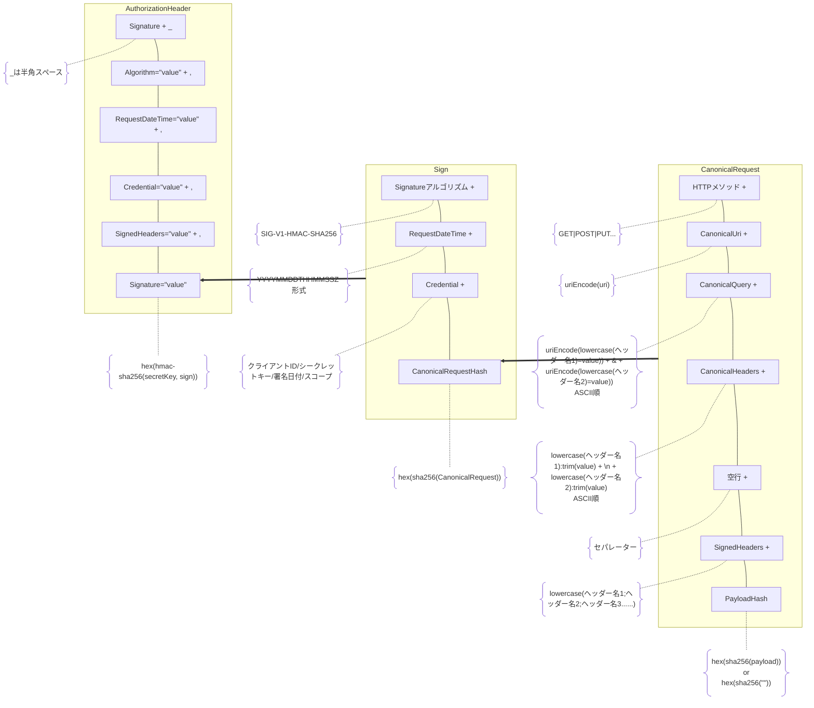

# 署名方式（Signature-V1）

本方式は、HTTP リクエスト全体を正規化した文字列に対して
HMAC-SHA256 による署名を行い、サーバー間通信の改ざん検知と認証を実現する。

## 署名計算処理



---

## Authorization ヘッダー

署名情報は HTTP Authorization ヘッダーに格納する。

**必須構成要素**

| 項目            | 説明                               |
| --------------- | ---------------------------------- |
| Algorithm       | 署名アルゴリズム                   |
| RequestDateTime | 送信日付。YYYYMMDDTHHMMSSZ　形式   |
| Credential      | 認証情報                           |
| SignedHeaders   | 署名対象に含めたヘッダー一覧       |
| Signature       | `sign` を HMAC-SHA256 で署名した値 |

**形式・ルール**

- 先頭に`Signature `を付与（固定文字列）。`Signature`の後に半角スペースがあることに注意
- 形式は、`key=value,`。改行コードなし
- RequestDateTime と サーバー受信時刻 との差 `+-5分`以内で検証とする（有効期限）
- value は必ずダブルクォート (`"`) で囲む
- value 内にダブルクォートを含めてはならない
- エスケープは認めない

**例**

```
Authorization: Signature Algorithm="SIG-V1-HMAC-SHA256",
RequestDateTime="20260102T015007Z",
Credential="01KDYC3MMJY8C9P32SQ1SYZT00/01KDYJJJEHHMRF7R5EX967RYJ1/20251201/SERVICE",
SignedHeaders="host;idempotency-key",
Signature="e7064feb09a0f6e9fbeac1d69754a53e0aa4d321dd026e8136bef3e375471f85"
```

※ 見やすさのために改行しているが実際は改行なし。

---

## Credential

**必須構成要素**

| 項目            | 説明                                         |
| --------------- | -------------------------------------------- |
| clientId        | クライアント識別子                           |
| secretKeyId     | シークレットキー識別子（鍵そのものではない） |
| 署名日付        | YYYMMDD 形式。リクエストの日付と時刻         |
| CredentialScope | 認証範囲                                     |

**形式・ルール**

- `クライアントID/シークレットキー/署名日付/スコープ` 形式
- クライエントIDは、払い出されたIDを使用すること
- シークレットキーは、払い出されたキーを使用すること。暗号化して保存すること
- シークレットキーは、鍵そのものを設定してはならない
- 署名日付は、署名が有効な日付。当日、あるいは翌日を指定可能

**例**

```
01KDYC3MMJY8C9P32SQ1SYZT00/01KDYJJJEHHMRF7R5EX967RYJ1/20251201/SERVICE
```

---

## Signature

署名対象となる文字列に対して、署名キーを用いて 署名を計算した値

**形式・ルール**

- 署名対象となる文字列（`sign`）をハッシュ化（`hamc-sha256(secretkey, sign)`）
- 小文字 16 進数表現とする

**例**

```
e7064feb09a0f6e9fbeac1d69754a53e0aa4d321dd026e8136bef3e375471f85
```

---

## sign

署名対象となる文字列。

| 項目                        | 説明                                              |
| --------------------------- | ------------------------------------------------- |
| Signatureアルゴリズム       | `SIG-V1-HMAC-SHA256` 固定                         |
| 送信日付（RequestDateTime） | `YYYYMMDDTHHMMSSZ` 形式                           |
| Credential                  | クレデンシャル                                    |
| CanonicalRequestHash        | `CanonicalRequest` の `SHA-256` ハッシュ値（hex） |

**形式・ルール**

- 形式は、`value,\n`。ただし最後は改行コードがなし
- Signature = hamc-sha256(secretkey, sign)
- CanonicalRequestHashは、小文字 16進数表現

```
SIG-V1-HMAC-SHA256\n
20260102T015007Z\n
01KDYC3MMJY8C9P32SQ1SYZT00/01KDYJJJEHHMRF7R5EX967RYJ1/20251201/SERVICE\n
db72c2f8d5e2c95db28805f50374aa1bfc876d8fb458c197e8a7871431f44f87
```

---

## CanonicalRequest

「署名契約書」
HTTP リクエスト全体を一意に表現した正規化文字列。
署名は、この CanonicalRequest に対して行われる。

**必須構成要素**

| 項目             | 説明                           |
| ---------------- | ------------------------------ |
| Method           | HTTP メソッド（大文字）        |
| CanonicalUri     | APIのURI                       |
| CanonicalQuery   | 正規化された署名対象クエリ     |
| CanonicalHeaders | 正規化された署名対象ヘッダー   |
| 空行             | セパレータ                     |
| SignedHeaders    | 署名対象ヘッダーの一覧（宣言） |
| PayloadHash      | HTTP Body の SHA-256 ハッシュ  |

**形式・ルール**

- `value,\n` 形式。ただし最後は改行コードがなし
- CanonicalUriは、ドメイン後の`/`から最後まで。もしクエリパラメータがある場合は疑問符文字 (`?`) まで
- 各要素は LF (`\n`) で区切る
- 余分な空白・空行は禁止

**例**

```
POST\n
/api/v1/orders\n
run=true&limit=12\n
host:api.example.com\n
idempotency-key:614403e5-cac5-5564-029a-c1619051e365\n
\n
host;idempotency-key\n
26ec6b376d01d429fe184117d407a383964f829b6c0831ea311764951ca4d9f4
```

---

## CanonicalQuery

**形式・ルール**

- `key=value&key=value` 形式。最後は`&`がないことに注意
- クエリパラメーター名は RFC3986 に従って URL エンコードする
- クエリパラーターが存在しない場合は空文字（`""`）
- クエリパラーターはあるが値がない場合は値を空（`key=""`）
- クエリパラメーター名で昇順とする（ASCII順）

**例**

```
run=true&limit=12
```

## CanonicalHeaders

「署名対象の最小セット」
どのヘッダーを、どのように正規化して署名したかを示す。

形式は`key:value`とする。

**必須構成要素**

| 項目            | 説明                                  |
| --------------- | ------------------------------------- |
| Host            | HTTP ホスト名（スキーム・パスを除く） |
| Idempotency-Key | 冪等性ー（存在する場合のみ設定）      |

**形式・ルール**

- `key:value\n` 形式。ただし最後は改行コードがなし
- 複数値ヘッダーの値をカンマで区切る
- ヘッダー名は小文字（`lowercase(value)`）
- ヘッダー名の昇順（ASCII順）
- 値は先頭と末尾のスペースは全てトリム（`trim(value)`）
- Content-Typeヘッダーなど標準のヘッダーも含めることは可能（User-Agent、acceptなども含めなくても良い）
- Authorizationヘッダーは含めない
- Idempotency-Keyがある場合は必須で設定するがない場合は含めない

**例**

```
host:api.example.com\n
idempotency-key:614403e5-cac5-5564-029a-c1619051e365
```

---

## SignedHeaders

署名対象ヘッダーの一覧を示す（**宣言**）。
CanonicalHeaders に含まれるヘッダーと 必ず対応する。

**形式・ルール**

- `key;key;key` 形式。ただし最後`;`がないことに注意
- ヘッダー名のみを含め、値は含めない

**例**

```
host;idempotency-key
```

## PayloadHash

PayloadHash（`sha256Hex(body)`）は、ペイロード（ボディがない）のハッシュ値

**形式・ルール**

- ペイロードがない場合（ボディがない）の値は、空文字（`sha256Hex("")`）
- ハッシュ化した値の小文字 16進数表現

**例**

```
db72c2f8d5e2c95db28805f50374aa1bfc876d8fb458c197e8a7871431f44f87
```

---

## 検証手順（サーバー側）

1. Authorization ヘッダーを解析する
2. RequestDateTime が ±5分以内か検証する
3. Credential から clientId / secretKeyId を取得する
4. リクエストから CanonicalRequest を再構築する
5. sign を生成する
6. HMAC-SHA256 で Signature を計算する
7. Authorization.Signature と一致するか検証する

```

```
