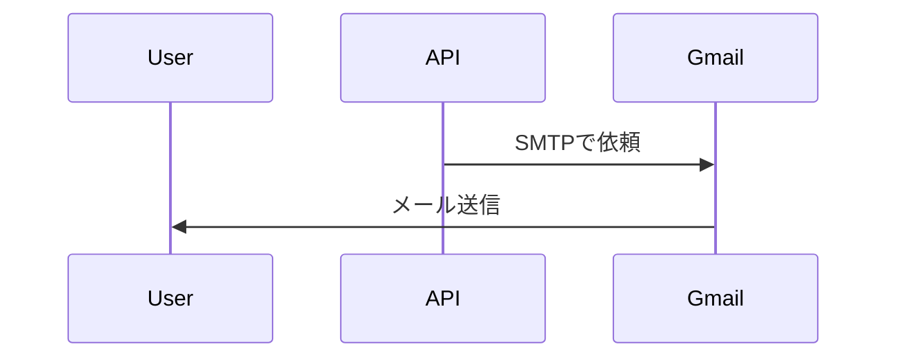
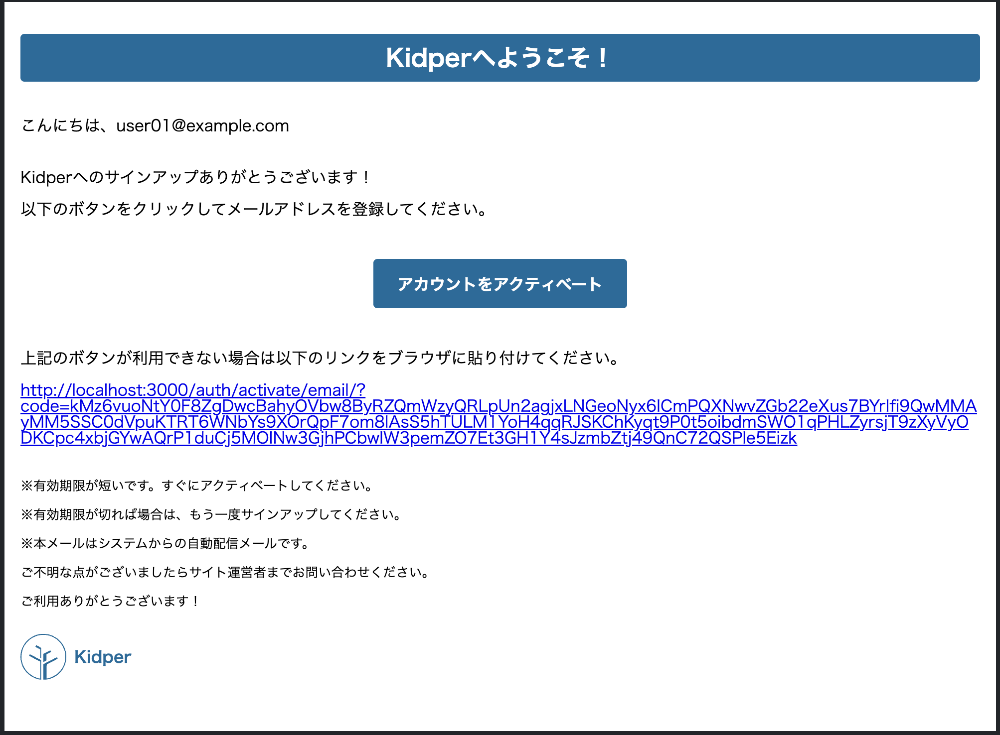

## アプリの設定

```yaml
mail:
  personal: Kidper
  address: kidper.info
  host: ${SMTP_HOST}
  port: ${SMTP_PORT}
  username: ${SMTP_USER_NAME}
  password: ${SMTP_PASSWORD}
  properties:
    mail:
      smtp:
        auth: true
        starttls.enable: true
```

## ファミリー招待

### ヘッダー

| キー         | 値                                            |
| ------------ | --------------------------------------------- |
| Content-Type | `multipart/mixed`                             |
| Date         | `Tue, 30 Dec 2025 12:59:58 +0900 (JST)`       |
| From         | `Kidper <kidper.info>`                        |
| Message-Id   | `<1775616176.5.1767067198835@localhost>`      |
| Mime-Version | `1.0`                                         |
| Received     | `from localhost (unknown [192.168.65.1]) xxx` |
| Return-Path  | `<kidper.info>`                               |
| Subject      | `=?UTF-8xxx`                                  |
| To           | `user01@example.com`                          |

### メール本文

※ 実際のメールとは文言などが異なります（サンプルです）。


