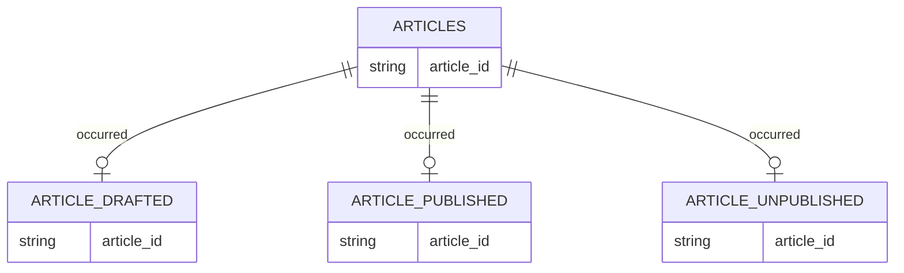
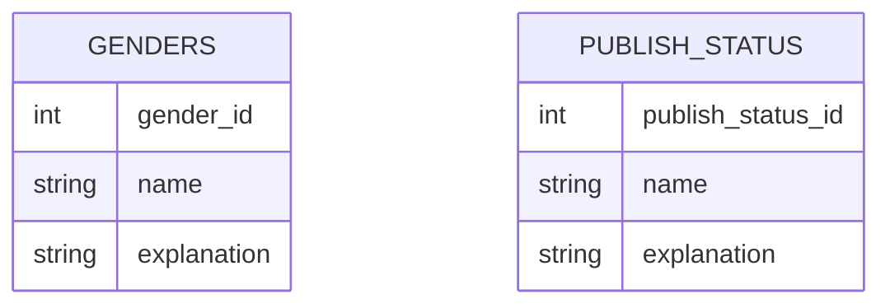
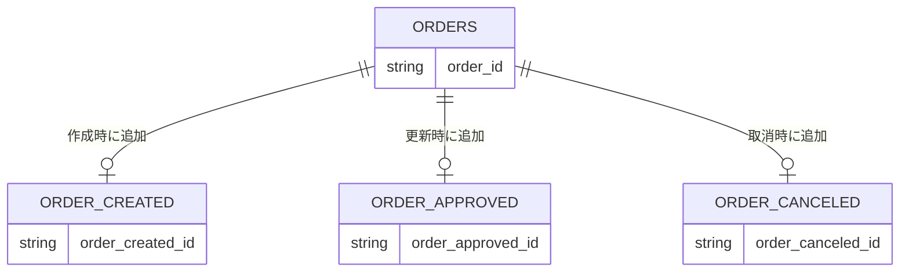
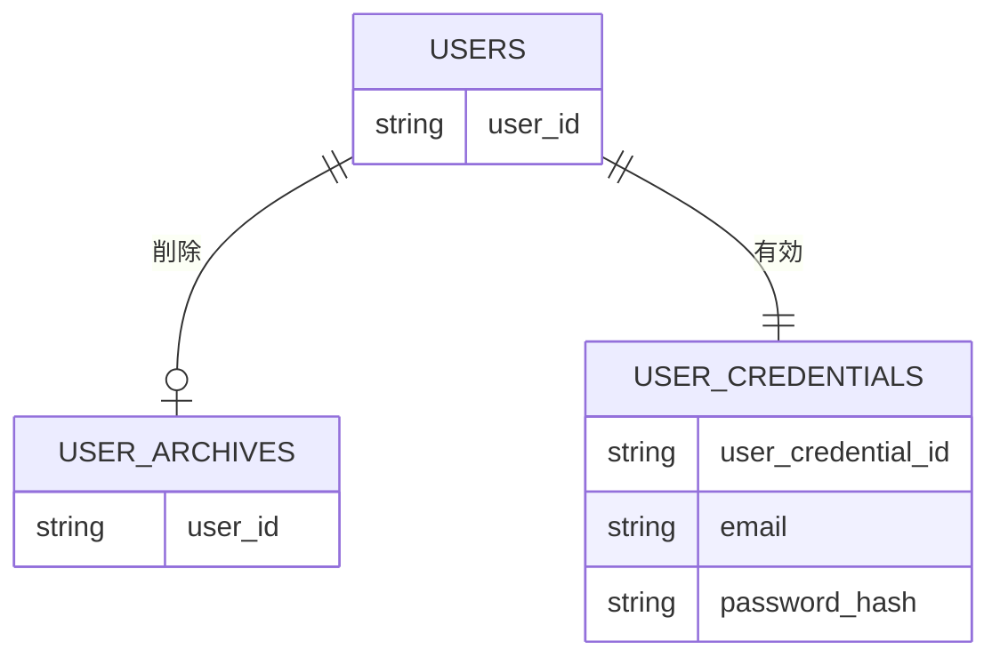

RDBベース事実中心設計ガイドライン

本ガイドラインは、RDBの制約を最大限活用し、
事実を中心とした堅牢かつ監査可能なデータモデルを実現するための基準である。

## 強制度

本ガイドラインは MUST / SHOULD / MAY に基づく。

- `MUST` : 必須。違反は不可
- `SHOULD` : 原則必須。例外は設計レビュー承認が必要
- `MAY` : 任意

---

## イベントテーブル設計

### 単一テーブル方式

同一リソースに対して発生する複数のイベントを、1つのテーブルに `INSERT` で蓄積する方式。

例として、記事の状態遷移を考える。

この場合、以下のようにイベントを追加していく。

> Draft（未公開） → Published（公開） → Draft（未公開） → Unpublished（非公開）

以下のように同一テーブルにイベントがをINSERTすることで、イベントを記録する。

**articles**

| sequence | article_id | event_type  |
| -------- | ---------- | ----------- |
| 1        | 1          | DRAFTED     |
| 2        | 1          | PUBLISHED   |
| 3        | 1          | DRAFTED     |
| 4        | 1          | UNPUBLISHED |

### 複数テーブル方式

イベントごとに専用テーブルを設ける方式。

親リソースを用意し、イベント発生時に該当テーブルへ `INSERT` する。

イベントごとにテーブルがあるためイベントごとにデータ構造が異なっても対応可能である。

**テーブル**

- articles
- article_drafted
- article_published
- article_unpublished

この方式では、イベントごとに異なるデータ構造を持つことが可能である。

### 運用方法

- イベントを履歴として残す場合は、`INSERT Only` とする。
- 状態遷移のみを表現する場合は、旧イベントを削除し新イベントへ移行する方法も許容する。
- パフォーマンス向上のため、スナップショットを別途保持することも可能。

### 単一テーブル方式と複数テーブル方式の選択

**単一テーブル方式**

- メリット: 1テーブルのみでシンプル
- デメリット: 全てのイベントで同じデータを持つ、表現力が乏しい

**複数テーブル方式**

- メリット: イベントごとに異なるデータ構造を持つことが可能
- デメリット: イベントが増えればテーブルも増えて複雑さが増す

どちらが優れているかではなく、業務特性に応じて選択する。

- イベント構造が単純で共通 → 単一テーブル方式
- イベントごとに異なるデータを有する → 複数テーブル方式

---

## テーブル種類

テーブルは「リソース」と「イベント」に明確に分離すること（MUST）

- **リソース**は、「識別子としての存在」
- **イベント**は、「時間の中で発生した不可逆な事実」

判断軸の一つとして日時属性の有無がある。ただし、予定日や有効期限は事実発生日時ではない。

### リソーステーブル

リソースは「誰が」「何が」に該当する永続的存在である。

#### 識別子リソース

- IDのみ、または限定的な情報のみを持つ親テーブル
- `UPDATE` 禁止（MUST）

例：

- users
- orders
- articles

---

#### 値リソース

あらかじめ定義され、変更されない値を保持するテーブル。

- プログラムからのSQL操作禁止（MUST）
- リリース単位でのみ変更可能（MUST）
- 主キーは連番

### イベント

イベントは「いつ」「どのリソースが」「何をしたか」を記録する。

- 属性変更はすべてイベントで表現する（MUST）
- 例外的に単一値保持が必要な技術属性（例：パスワード）はリソース更新を許容（MAY）

例

- article_title_changed
- order_address_changed

---

## 事実中心設計

- テーブルは状態ではなく事実を保存する（MUST）
- 現在状態を直接保持してはならない（MUST）
- 状態変更は `UPDATE` ではなく新規 `INSERT` とする（MUST）

---

## INSERT Only 原則

- イベントテーブルで `UPDATE` を禁止する（MUST）
- 修正は修正イベントで表現する（MUST）
- 論理削除フラグなどの技術的状態管理は禁止（MUST）

---

## 状態カラム禁止

- リソースに状態カラムを持たせてはならない（MUST）
- 状態はイベントから導出する（MUST）

---

## 任意項目の分離

- NULL原則禁止（MUST）
- 任意情報は別テーブルで表現する（MUST）
- レコードの存在が事実成立を意味する設計とする（MUST）

---

## テーブル1時間軸

- 1テーブルは1つの事実のみを表現する（MUST）
- イベントテーブルは業務日時を1つのみ持つ（MUST）
- 複数意味の日時を混在させない（MUST）
- 日時を1つだけ持つテーブルは `INSERT Only` とする

---

## テーブル設計

### 主キー

- リソース・イベントは UUID または ULID（MUST）
- PKとは別に業務キーへ UNIQUE制約を設ける（MUST）
- 値リソースは連番

### 外部キー制約

- 業務的関連は必ず FK制約を持つ（MUST）
- アプリケーションのみで整合性を担保してはならない（MUST）

### 一意制約

- 業務的に一意なものは UNIQUE制約を設ける（MUST）
- 前提に依存して制約を省略してはならない（MUST）

### NOT NULL 制約

- 原則全カラム NOT NULL（MUST）
- もしTBLにNULLが入る場合は設計の見直しをすること（MUST）
- NULLで未確定を表現してはならない（MUST）
- 外部連携など不完全データは専用テーブルで扱う（MUST）

---

## データ更新ルール

### イベント

- 上書き更新禁止（MUST）
- 修正は修正イベント追加（MUST）
- 削除は削除イベントで表現（MUST）

### リソース削除

- パスワードなど1つしか持てない、過去の値を残せない場合などやむ負えない場合は更新する
- 更新の方法は、1度DELETEして更新したリソースをINSERTを行う（主キーを連番にするとこれができないため留意）。
- リソースを削除できる場合は物理削除する（MUST）
- 物理削除できない場合、削除用のTBLに移動する。

### リソース削除例

物理削除できないケースとして、ユーザーを削除を考えてほしい。

ユーザーIDが外部キーに使用されているため、物理削除が困難な状況がある。

usersという親テーブルを用意し、IDだけ持たせて、ユーザーの属性はユーザープロフィールなどの別テーブルに持たせる。

また、ユーザーの場合は、認証情報が必要なためuser_credentialsを持たせる。この認証情報が存在していれば削除されていないユーザーとして扱う。

ユーザーを削除する場合は、user_credentialsを物理削除すると同時に、user_archivesに残したい情報を移動して保存する。

こうすれば、ユーザーのように多数の外部キーとして紐づいている場合でもゆっくりと削除していくことが可能になる。

また、一定期間の間は削除要請があった情報を残すなどの業務要件を実現可能となる。
例えば、ユーザー以外にも社員情報を管理している場合に、退職した社員情報を一定期間は保持しなければならないと決めれている状況でも対応できる。

---

## 監査可能性

すべての事実は「いつ」「誰が」発生させたかを保持する（MUST）

- 発生日時（occurred_at）......請求作成日、注文日など
- 発生主体（occurred_by）......請求ユーザー、注文アカウントなど
- `occurred`は適切な名称に変更すること（MAY）

---

## 導出とスナップショット

### 状態は導出

- 現在状態はイベントから導出する（MUST）
- 任意時点状態を再構成可能であること（MUST）

### スナップショット

- スナップショットは事実ではない（MUST）
- 正と扱ってはならない（MUST）
- 再生成可能であること（MUST）
- パフォーマンス目的で使用可（MAY）

---

## 命名規則

### テーブル名

- リソーステーブルは、複数形（MUST）
- 業務概念を明確に表現（MUST）
- 親子関係がある場合は、「`親テーブル`（単数） + `_` + `リソース`（複数）」形式
- イベントは「`resource` + `_` + `event`（過去形）」形式

**親子関係の例**

- users
  - user_profiles
- contents
  - content_types

**イベントテーブルの例**

OKな例

- order_approved
- article_published

NGな例

- order_status_history
- order_status_event

---

### カラム名

- 意味を持つ名称（MUST）
- id単独禁止（MUST）
- フラグ命名原則禁止（SHOULD）
- 不要語禁止（情報・データ・管理・履歴 等）
- 過度な短縮禁止（MUST）
- ローマ字禁止（MUST）
- 無くても意味が通じるワードはつけない（MUST）
  - 情報
  - データ
  - 処理
  - 〜物
  - マスタ
  - 記録
  - 管理
  - 〜履歴

### 日時カラム

- occurred_at を標準（MUST）
- created_at / updated_at を業務事実に使用禁止（MUST）
- ISO 8601（SHOULD）
- JST基準（MUST）

---

## 禁止事項

- 状態テーブルの単独管理（MUST）
- 更新履歴を持たない UPDATE 設計（MUST）
- フラグによる業務状態管理（MUST）
- 業務DELETE（MUST）
- NULL多用設計（MUST）
- アプリケーションのみで整合性担保（MUST）
- 集計テーブルを真実と扱うこと（MUST）
