# library

## テーブル一覧

| 名前                                                              | カラム一覧 | コメント                              | タイプ     |
| ----------------------------------------------------------------- | ---------- | ------------------------------------- | ---------- |
| [child_members](child_members.md)                                 | 4          | 子どもメンバーTBL                     | BASE TABLE |
| [children](children.md)                                           | 5          | 子どもTBL                             | BASE TABLE |
| [content_blacklists](content_blacklists.md)                       | 5          | コンテントブラックリストTBL           | BASE TABLE |
| [content_media_type](content_media_type.md)                       | 3          | コンテントメディアタイプマスターTBL   | BASE TABLE |
| [content_publish_scope](content_publish_scope.md)                 | 3          | コンテント公開範囲タイプマスターTBL   | BASE TABLE |
| [content_publish_scope_members](content_publish_scope_members.md) | 3          | コンテント公開範囲メンバーTBL         | BASE TABLE |
| [content_type](content_type.md)                                   | 3          | コンテントタイプマスターTBL           | BASE TABLE |
| [contents](contents.md)                                           | 12         | コンテントTBL                         | BASE TABLE |
| [families](families.md)                                           | 4          | ファミリーTBL                         | BASE TABLE |
| [family_invitations](family_invitations.md)                       | 7          | ファミリー招待TBL                     | BASE TABLE |
| [family_member_role_type](family_member_role_type.md)             | 4          | ファミリーメンバー権限マスターTBL     | BASE TABLE |
| [family_members](family_members.md)                               | 6          | ファミリーメンバーTBL                 | BASE TABLE |
| [flyway_schema_history](flyway_schema_history.md)                 | 10         |                                       | BASE TABLE |
| [one_time_passwords](one_time_passwords.md)                       | 4          | ワンタイムパスワードTBL               | BASE TABLE |
| [post_contents](post_contents.md)                                 | 3          | ポストコンテンツTBL                   | BASE TABLE |
| [posts](posts.md)                                                 | 7          | コンテント投稿TBL                     | BASE TABLE |
| [publish_status](publish_status.md)                               | 3          | 公開ステータスマスターTBL             | BASE TABLE |
| [recovery_codes](recovery_codes.md)                               | 3          | リカバリーコードTBL                   | BASE TABLE |
| [sex](sex.md)                                                     | 3          | 性別マスターTBL                       | BASE TABLE |
| [temporarily_user_status](temporarily_user_status.md)             | 3          | 仮ユーザーステータスマスターTBl       | BASE TABLE |
| [temporarily_users](temporarily_users.md)                         | 9          | 仮ユーザーTBL                         | BASE TABLE |
| [user_access_history](user_access_history.md)                     | 4          | ユーザーログイン履歴TBL               | BASE TABLE |
| [user_access_status](user_access_status.md)                       | 3          | ユーザーアクセスステータスマスターTBL | BASE TABLE |
| [user_auth_token_blacklists](user_auth_token_blacklists.md)       | 3          | ユーザー認証トークンブラックリストTBL | BASE TABLE |
| [user_auths](user_auths.md)                                       | 5          | ユーザー認証TBL                       | BASE TABLE |
| [user_device_status](user_device_status.md)                       | 3          | ユーザーデバイスステータスマスターTBL | BASE TABLE |
| [user_devices](user_devices.md)                                   | 5          | ユーザーデバイスTBL                   | BASE TABLE |
| [user_profiles](user_profiles.md)                                 | 4          | ユーザープロフィールTBL               | BASE TABLE |
| [user_role_type](user_role_type.md)                               | 3          | ユーザー権限マスターTBL               | BASE TABLE |
| [users](users.md)                                                 | 2          | ユーザー情報TBL                       | BASE TABLE |

## ER図

```mermaid
erDiagram

"child_members" }o--|| "children" : "FOREIGN KEY (child_id) REFERENCES children (child_id)"
"child_members" }o--|| "families" : "FOREIGN KEY (family_id) REFERENCES families (family_id)"
"children" }o--|| "sex" : "FOREIGN KEY (sex_id) REFERENCES sex (sex_id)"
"content_blacklists" }o--|| "users" : "FOREIGN KEY (user_id) REFERENCES users (user_id)"
"content_publish_scope_members" }o--|| "content_publish_scope" : "FOREIGN KEY (content_publish_scope_id) REFERENCES content_publish_scope (content_publish_scope_id)"
"contents" }o--|| "content_type" : "FOREIGN KEY (content_type_id) REFERENCES content_type (content_type_id)"
"contents" }o--|| "content_media_type" : "FOREIGN KEY (content_media_type_id) REFERENCES content_media_type (content_media_type_id)"
"contents" }o--|| "users" : "FOREIGN KEY (create_user_id) REFERENCES users (user_id)"
"contents" }o--|| "families" : "FOREIGN KEY (family_id) REFERENCES families (family_id)"
"families" }o--|| "users" : "FOREIGN KEY (create_user_id) REFERENCES users (user_id)"
"family_invitations" }o--|| "family_member_role_type" : "FOREIGN KEY (family_member_role_type_id) REFERENCES family_member_role_type (family_member_role_type_id)"
"family_invitations" }o--|| "users" : "FOREIGN KEY (host_user_id) REFERENCES users (user_id)"
"family_invitations" }o--|| "families" : "FOREIGN KEY (family_id) REFERENCES families (family_id)"
"family_members" }o--|| "users" : "FOREIGN KEY (user_id) REFERENCES users (user_id)"
"family_members" }o--|| "families" : "FOREIGN KEY (family_id) REFERENCES families (family_id)"
"family_members" }o--|| "family_member_role_type" : "FOREIGN KEY (family_member_role_type_id) REFERENCES family_member_role_type (family_member_role_type_id)"
"one_time_passwords" }o--|| "users" : "FOREIGN KEY (user_id) REFERENCES users (user_id)"
"post_contents" }o--|| "posts" : "FOREIGN KEY (post_id) REFERENCES posts (post_id)"
"post_contents" }o--|| "contents" : "FOREIGN KEY (content_id) REFERENCES contents (content_id)"
"posts" }o--|| "publish_status" : "FOREIGN KEY (publish_status_id) REFERENCES publish_status (publish_status_id)"
"posts" }o--|| "content_publish_scope" : "FOREIGN KEY (content_publish_scope_id) REFERENCES content_publish_scope (content_publish_scope_id)"
"posts" }o--|| "users" : "FOREIGN KEY (create_user_id) REFERENCES users (user_id)"
"posts" }o--|| "families" : "FOREIGN KEY (family_id) REFERENCES families (family_id)"
"posts" }o--|| "children" : "FOREIGN KEY (child_id) REFERENCES children (child_id)"
"recovery_codes" }o--|| "users" : "FOREIGN KEY (user_id) REFERENCES users (user_id)"
"temporarily_users" }o--|| "temporarily_user_status" : "FOREIGN KEY (temporarily_user_status_id) REFERENCES temporarily_user_status (temporarily_user_status_id)"
"temporarily_users" }o--|| "user_role_type" : "FOREIGN KEY (user_role_type_id) REFERENCES user_role_type (user_role_type_id)"
"user_access_history" }o--|| "users" : "FOREIGN KEY (user_id) REFERENCES users (user_id)"
"user_access_history" }o--|| "user_access_status" : "FOREIGN KEY (user_access_status_id) REFERENCES user_access_status (user_access_status_id)"
"user_auth_token_blacklists" }o--|| "users" : "FOREIGN KEY (user_id) REFERENCES users (user_id)"
"user_auths" }o--|| "users" : "FOREIGN KEY (user_id) REFERENCES users (user_id)"
"user_devices" }o--|| "user_device_status" : "FOREIGN KEY (user_device_status_id) REFERENCES user_device_status (user_device_status_id)"
"user_devices" }o--|| "users" : "FOREIGN KEY (user_id) REFERENCES users (user_id)"
"user_profiles" |o--|| "users" : "FOREIGN KEY (user_id) REFERENCES users (user_id)"
"user_profiles" }o--|| "user_role_type" : "FOREIGN KEY (user_role_type_id) REFERENCES user_role_type (user_role_type_id)"

"child_members" {
  varchar_36_ child_member_id PK "子どもメンバーID"
  varchar_36_ child_id FK "子どもID"
  varchar_36_ family_id FK "ファミリーID"
}
"children" {
  varchar_36_ child_id PK "子どもID"
  int sex_id FK "性別ID"
}
"content_blacklists" {
  varchar_36_ content_blacklist_id PK "コンテントブラックリストID"
  varchar_36_ user_id FK "ユーザーID"
}
"content_media_type" {
  int content_media_type_id PK "コンテントメディアタイプID"
}
"content_publish_scope" {
  int content_publish_scope_id PK "コンテント公開範囲ID"
}
"content_publish_scope_members" {
  int content_publish_scope_member_id PK "コンテント公開範囲メンバーID"
  int content_publish_scope_id FK "コンテント公開範囲ID"
}
"content_type" {
  int content_type_id PK "コンテントタイプID"
}
"contents" {
  varchar_36_ content_id PK "コンテントID"
  int content_type_id FK "コンテントタイプID"
  int content_media_type_id FK "コンテントメディアタイプID"
  varchar_36_ create_user_id FK "作成ユーザーID"
  varchar_36_ family_id FK "ファミリーID"
}
"families" {
  varchar_36_ family_id PK "ファミリーID"
  varchar_36_ create_user_id FK "作成ユーザーID"
}
"family_invitations" {
  varchar_36_ family_invitation_id PK "ファミリー招待ID"
  int family_member_role_type_id FK "ファミリーメンバー権限ID"
  varchar_36_ host_user_id FK "差出ユーザーID"
  varchar_36_ family_id FK "ファミリーID"
}
"family_member_role_type" {
  int family_member_role_type_id PK "ファミリーメンバー権限ID"
}
"family_members" {
  varchar_36_ family_member_id PK "ファミリーメンバーID"
  varchar_36_ user_id FK "ユーザーID"
  varchar_36_ family_id FK "ファミリーID"
  int family_member_role_type_id FK "ファミリーメンバー権限ID"
}
"flyway_schema_history" {
  int installed_rank PK ""
}
"one_time_passwords" {
  varchar_36_ one_time_password_id PK "ワンタイムパスワードID"
  varchar_36_ user_id FK "ユーザーID"
}
"post_contents" {
  varchar_36_ post_id PK "ポストID"
  varchar_36_ content_id PK "コンテントID"
}
"posts" {
  varchar_36_ post_id PK "ポストID"
  int publish_status_id FK "公開ステータスID"
  int content_publish_scope_id FK "コンテント公開範囲ID"
  varchar_36_ create_user_id FK "ユーザーID"
  varchar_36_ family_id FK "ファミリーID"
  varchar_36_ child_id FK "子どもID"
}
"publish_status" {
  int publish_status_id PK "公開ステータスID"
}
"recovery_codes" {
  varchar_36_ user_id PK "ユーザーID"
  char_60_ encrypted_recovery_code PK "暗号化済みリカバリーコード"
}
"sex" {
  int sex_id PK "性別ID"
}
"temporarily_user_status" {
  int temporarily_user_status_id PK "仮ユーザーステータスID"
}
"temporarily_users" {
  varchar_36_ temporarily_user_id PK "仮ユーザーID"
  int temporarily_user_status_id FK "仮ユーザーステータスID"
  int user_role_type_id FK "ユーザー権限ID"
}
"user_access_history" {
  varchar_36_ user_access_history_id PK "ユーザーアクセス履歴ID"
  varchar_36_ user_id FK "ユーザーID"
  int user_access_status_id FK "ユーザーアクセスステータスID"
}
"user_access_status" {
  int user_access_status_id PK "ユーザーアクセスステータスID"
}
"user_auth_token_blacklists" {
  varchar_355_ token PK "トークン"
  varchar_36_ user_id FK "ユーザーID"
}
"user_auths" {
  varchar_36_ user_auth_id PK "ユーザー認証ID"
  varchar_36_ user_id FK "ユーザーID"
}
"user_device_status" {
  int user_device_status_id PK "ユーザーデバイスステータスID"
}
"user_devices" {
  varchar_36_ user_device_id PK "ユーザーデバイスID"
  int user_device_status_id FK "ユーザーデバイスステータス"
  varchar_36_ user_id FK "ユーザーID"
}
"user_profiles" {
  varchar_36_ user_id PK "ユーザーID"
  int user_role_type_id FK "ユーザー権限ID"
}
"user_role_type" {
  int user_role_type_id PK "ユーザー権限ID"
}
"users" {
  varchar_36_ user_id PK "ユーザーID"
}
```

---

> Generated by [tbls](https://github.com/k1LoW/tbls)
