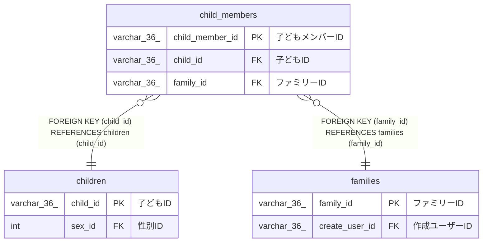

# child_members

## 概要

子どもメンバーTBL

<details>
<summary><strong>テーブル定義</strong></summary>

```sql
CREATE TABLE `child_members` (
  `child_member_id` varchar(36) NOT NULL COMMENT '子どもメンバーID',
  `child_id` varchar(36) NOT NULL COMMENT '子どもID',
  `family_id` varchar(36) NOT NULL COMMENT 'ファミリーID',
  `created_at` datetime(6) NOT NULL COMMENT '作成日時',
  PRIMARY KEY (`child_member_id`),
  KEY `child_id` (`child_id`),
  KEY `family_id` (`family_id`),
  CONSTRAINT `child_members_ibfk_1` FOREIGN KEY (`child_id`) REFERENCES `children` (`child_id`),
  CONSTRAINT `child_members_ibfk_2` FOREIGN KEY (`family_id`) REFERENCES `families` (`family_id`)
) ENGINE=InnoDB DEFAULT CHARSET=utf8mb4 COLLATE=utf8mb4_0900_ai_ci COMMENT='子どもメンバーTBL'
```

</details>

## カラム一覧

| 名前            | タイプ      | デフォルト値 | Nullable | 子テーブル | 親テーブル              | コメント         |
| --------------- | ----------- | ------------ | -------- | ---------- | ----------------------- | ---------------- |
| child_member_id | varchar(36) |              | false    |            |                         | 子どもメンバーID |
| child_id        | varchar(36) |              | false    |            | [children](children.md) | 子どもID         |
| family_id       | varchar(36) |              | false    |            | [families](families.md) | ファミリーID     |
| created_at      | datetime(6) |              | false    |            |                         | 作成日時         |

## 制約一覧

| 名前                 | タイプ      | 定義                                                    |
| -------------------- | ----------- | ------------------------------------------------------- |
| child_members_ibfk_1 | FOREIGN KEY | FOREIGN KEY (child_id) REFERENCES children (child_id)   |
| child_members_ibfk_2 | FOREIGN KEY | FOREIGN KEY (family_id) REFERENCES families (family_id) |
| PRIMARY              | PRIMARY KEY | PRIMARY KEY (child_member_id)                           |

## INDEX一覧

| 名前      | 定義                                      |
| --------- | ----------------------------------------- |
| child_id  | KEY child_id (child_id) USING BTREE       |
| family_id | KEY family_id (family_id) USING BTREE     |
| PRIMARY   | PRIMARY KEY (child_member_id) USING BTREE |

## ER図



---

> Generated by [tbls](https://github.com/k1LoW/tbls)
