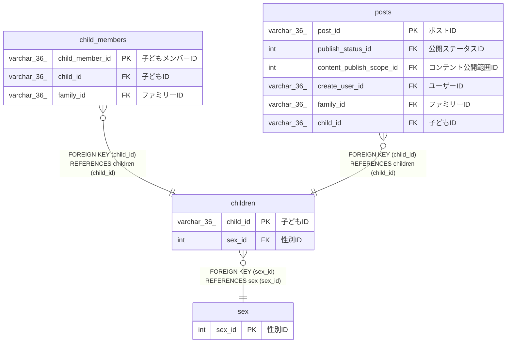

# children

## 概要

子どもTBL

<details>
<summary><strong>テーブル定義</strong></summary>

```sql
CREATE TABLE `children` (
  `child_id` varchar(36) NOT NULL COMMENT '子どもID',
  `child_name` varchar(100) NOT NULL COMMENT '子ども名',
  `sex_id` int NOT NULL COMMENT '性別ID',
  `birthday` date NOT NULL COMMENT '生年月日',
  `created_at` datetime(6) NOT NULL COMMENT '作成日時',
  PRIMARY KEY (`child_id`),
  KEY `sex_id` (`sex_id`),
  CONSTRAINT `children_ibfk_1` FOREIGN KEY (`sex_id`) REFERENCES `sex` (`sex_id`)
) ENGINE=InnoDB DEFAULT CHARSET=utf8mb4 COLLATE=utf8mb4_0900_ai_ci COMMENT='子どもTBL'
```

</details>

## カラム一覧

| 名前       | タイプ       | デフォルト値 | Nullable | 子テーブル                                          | 親テーブル    | コメント |
| ---------- | ------------ | ------------ | -------- | --------------------------------------------------- | ------------- | -------- |
| child_id   | varchar(36)  |              | false    | [child_members](child_members.md) [posts](posts.md) |               | 子どもID |
| child_name | varchar(100) |              | false    |                                                     |               | 子ども名 |
| sex_id     | int          |              | false    |                                                     | [sex](sex.md) | 性別ID   |
| birthday   | date         |              | false    |                                                     |               | 生年月日 |
| created_at | datetime(6)  |              | false    |                                                     |               | 作成日時 |

## 制約一覧

| 名前            | タイプ      | 定義                                         |
| --------------- | ----------- | -------------------------------------------- |
| children_ibfk_1 | FOREIGN KEY | FOREIGN KEY (sex_id) REFERENCES sex (sex_id) |
| PRIMARY         | PRIMARY KEY | PRIMARY KEY (child_id)                       |

## INDEX一覧

| 名前    | 定義                               |
| ------- | ---------------------------------- |
| sex_id  | KEY sex_id (sex_id) USING BTREE    |
| PRIMARY | PRIMARY KEY (child_id) USING BTREE |

## ER図



---

> Generated by [tbls](https://github.com/k1LoW/tbls)
