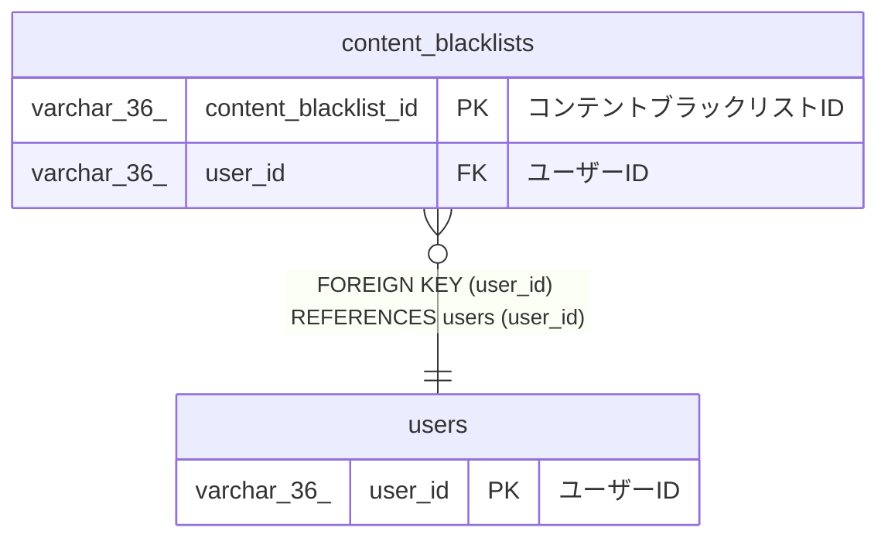

# content_blacklists

## 概要

コンテントブラックリストTBL

<details>
<summary><strong>テーブル定義</strong></summary>

```sql
CREATE TABLE `content_blacklists` (
  `content_blacklist_id` varchar(36) NOT NULL COMMENT 'コンテントブラックリストID',
  `checksum` char(40) NOT NULL COMMENT 'チェックサム',
  `original_file_name` varchar(255) NOT NULL COMMENT '元のファイル名',
  `user_id` varchar(36) NOT NULL COMMENT 'ユーザーID',
  `created_at` datetime(6) NOT NULL COMMENT '作成日時',
  PRIMARY KEY (`content_blacklist_id`),
  KEY `user_id` (`user_id`),
  CONSTRAINT `content_blacklists_ibfk_1` FOREIGN KEY (`user_id`) REFERENCES `users` (`user_id`)
) ENGINE=InnoDB DEFAULT CHARSET=utf8mb4 COLLATE=utf8mb4_0900_ai_ci COMMENT='コンテントブラックリストTBL'
```

</details>

## カラム一覧

| 名前                 | タイプ       | デフォルト値 | Nullable | 子テーブル | 親テーブル        | コメント                   |
| -------------------- | ------------ | ------------ | -------- | ---------- | ----------------- | -------------------------- |
| content_blacklist_id | varchar(36)  |              | false    |            |                   | コンテントブラックリストID |
| checksum             | char(40)     |              | false    |            |                   | チェックサム               |
| original_file_name   | varchar(255) |              | false    |            |                   | 元のファイル名             |
| user_id              | varchar(36)  |              | false    |            | [users](users.md) | ユーザーID                 |
| created_at           | datetime(6)  |              | false    |            |                   | 作成日時                   |

## 制約一覧

| 名前                      | タイプ      | 定義                                             |
| ------------------------- | ----------- | ------------------------------------------------ |
| content_blacklists_ibfk_1 | FOREIGN KEY | FOREIGN KEY (user_id) REFERENCES users (user_id) |
| PRIMARY                   | PRIMARY KEY | PRIMARY KEY (content_blacklist_id)               |

## INDEX一覧

| 名前    | 定義                                           |
| ------- | ---------------------------------------------- |
| user_id | KEY user_id (user_id) USING BTREE              |
| PRIMARY | PRIMARY KEY (content_blacklist_id) USING BTREE |

## ER図



---

> Generated by [tbls](https://github.com/k1LoW/tbls)
