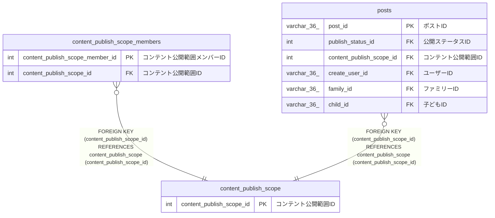

# content_publish_scope

## 概要

コンテント公開範囲タイプマスターTBL

<details>
<summary><strong>テーブル定義</strong></summary>

```sql
CREATE TABLE `content_publish_scope` (
  `content_publish_scope_id` int NOT NULL COMMENT 'コンテント公開範囲ID',
  `content_publish_scope_name` varchar(100) NOT NULL COMMENT 'コンテント公開範囲名',
  `explanation` varchar(100) NOT NULL COMMENT '説明',
  PRIMARY KEY (`content_publish_scope_id`),
  UNIQUE KEY `explanation` (`explanation`)
) ENGINE=InnoDB DEFAULT CHARSET=utf8mb4 COLLATE=utf8mb4_0900_ai_ci COMMENT='コンテント公開範囲タイプマスターTBL'
```

</details>

## カラム一覧

| 名前                       | タイプ       | デフォルト値 | Nullable | 子テーブル                                                                          | 親テーブル | コメント             |
| -------------------------- | ------------ | ------------ | -------- | ----------------------------------------------------------------------------------- | ---------- | -------------------- |
| content_publish_scope_id   | int          |              | false    | [content_publish_scope_members](content_publish_scope_members.md) [posts](posts.md) |            | コンテント公開範囲ID |
| content_publish_scope_name | varchar(100) |              | false    |                                                                                     |            | コンテント公開範囲名 |
| explanation                | varchar(100) |              | false    |                                                                                     |            | 説明                 |

## 制約一覧

| 名前        | タイプ      | 定義                                   |
| ----------- | ----------- | -------------------------------------- |
| explanation | UNIQUE      | UNIQUE KEY explanation (explanation)   |
| PRIMARY     | PRIMARY KEY | PRIMARY KEY (content_publish_scope_id) |

## INDEX一覧

| 名前        | 定義                                               |
| ----------- | -------------------------------------------------- |
| PRIMARY     | PRIMARY KEY (content_publish_scope_id) USING BTREE |
| explanation | UNIQUE KEY explanation (explanation) USING BTREE   |

## ER図



---

> Generated by [tbls](https://github.com/k1LoW/tbls)
