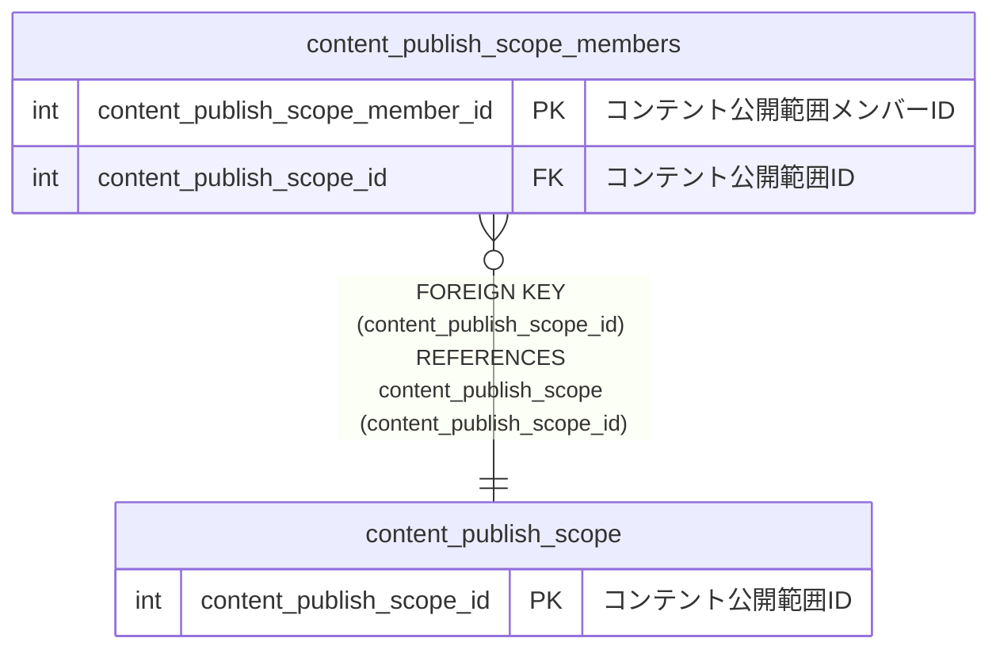

# content_publish_scope_members

## 概要

コンテント公開範囲メンバーTBL

<details>
<summary><strong>テーブル定義</strong></summary>

```sql
CREATE TABLE `content_publish_scope_members` (
  `content_publish_scope_member_id` int NOT NULL AUTO_INCREMENT COMMENT 'コンテント公開範囲メンバーID',
  `content_publish_scope_id` int NOT NULL COMMENT 'コンテント公開範囲ID',
  `content_publish_scope_member` varchar(36) NOT NULL COMMENT 'コンテント公開範囲メンバー',
  PRIMARY KEY (`content_publish_scope_member_id`),
  KEY `content_publish_scope_id` (`content_publish_scope_id`),
  CONSTRAINT `content_publish_scope_members_ibfk_1` FOREIGN KEY (`content_publish_scope_id`) REFERENCES `content_publish_scope` (`content_publish_scope_id`)
) ENGINE=InnoDB DEFAULT CHARSET=utf8mb4 COLLATE=utf8mb4_0900_ai_ci COMMENT='コンテント公開範囲メンバーTBL'
```

</details>

## カラム一覧

| 名前                            | タイプ      | デフォルト値 | Nullable | Extra Definition | 子テーブル | 親テーブル                                        | コメント                     |
| ------------------------------- | ----------- | ------------ | -------- | ---------------- | ---------- | ------------------------------------------------- | ---------------------------- |
| content_publish_scope_member_id | int         |              | false    | auto_increment   |            |                                                   | コンテント公開範囲メンバーID |
| content_publish_scope_id        | int         |              | false    |                  |            | [content_publish_scope](content_publish_scope.md) | コンテント公開範囲ID         |
| content_publish_scope_member    | varchar(36) |              | false    |                  |            |                                                   | コンテント公開範囲メンバー   |

## 制約一覧

| 名前                                 | タイプ      | 定義                                                                                               |
| ------------------------------------ | ----------- | -------------------------------------------------------------------------------------------------- |
| content_publish_scope_members_ibfk_1 | FOREIGN KEY | FOREIGN KEY (content_publish_scope_id) REFERENCES content_publish_scope (content_publish_scope_id) |
| PRIMARY                              | PRIMARY KEY | PRIMARY KEY (content_publish_scope_member_id)                                                      |

## INDEX一覧

| 名前                     | 定義                                                                |
| ------------------------ | ------------------------------------------------------------------- |
| content_publish_scope_id | KEY content_publish_scope_id (content_publish_scope_id) USING BTREE |
| PRIMARY                  | PRIMARY KEY (content_publish_scope_member_id) USING BTREE           |

## ER図



---

> Generated by [tbls](https://github.com/k1LoW/tbls)
