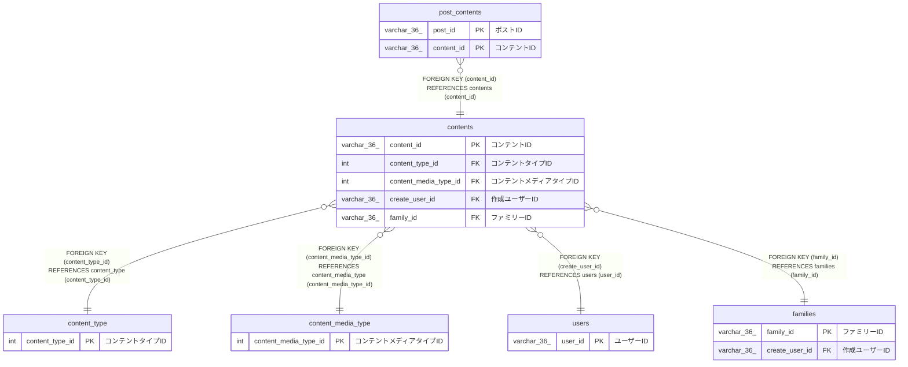

# contents

## 概要

コンテントTBL

<details>
<summary><strong>テーブル定義</strong></summary>

```sql
CREATE TABLE `contents` (
  `content_id` varchar(36) NOT NULL COMMENT 'コンテントID',
  `content_type_id` int NOT NULL COMMENT 'コンテントタイプID',
  `checksum` char(40) NOT NULL COMMENT 'チェックサム',
  `content_media_type_id` int NOT NULL COMMENT 'コンテントメディアタイプID',
  `content_file_size` int NOT NULL COMMENT 'コンテントファイルサイズ',
  `content_file_name` varchar(255) NOT NULL COMMENT 'コンテントファイル名',
  `original_file_name` varchar(255) NOT NULL COMMENT '元のファイル名',
  `content_path` varchar(255) NOT NULL COMMENT 'コンテントパス',
  `content_taken_at` datetime(6) NOT NULL COMMENT 'コンテント撮影日',
  `create_user_id` varchar(36) NOT NULL COMMENT '作成ユーザーID',
  `family_id` varchar(36) NOT NULL COMMENT 'ファミリーID',
  `created_at` datetime(6) NOT NULL COMMENT '作成日時',
  PRIMARY KEY (`content_id`),
  KEY `content_type_id` (`content_type_id`),
  KEY `content_media_type_id` (`content_media_type_id`),
  KEY `create_user_id` (`create_user_id`),
  KEY `family_id` (`family_id`),
  CONSTRAINT `contents_ibfk_1` FOREIGN KEY (`content_type_id`) REFERENCES `content_type` (`content_type_id`),
  CONSTRAINT `contents_ibfk_2` FOREIGN KEY (`content_media_type_id`) REFERENCES `content_media_type` (`content_media_type_id`),
  CONSTRAINT `contents_ibfk_3` FOREIGN KEY (`create_user_id`) REFERENCES `users` (`user_id`),
  CONSTRAINT `contents_ibfk_4` FOREIGN KEY (`family_id`) REFERENCES `families` (`family_id`)
) ENGINE=InnoDB DEFAULT CHARSET=utf8mb4 COLLATE=utf8mb4_0900_ai_ci COMMENT='コンテントTBL'
```

</details>

## カラム一覧

| 名前                  | タイプ       | デフォルト値 | Nullable | 子テーブル                        | 親テーブル                                  | コメント                   |
| --------------------- | ------------ | ------------ | -------- | --------------------------------- | ------------------------------------------- | -------------------------- |
| content_id            | varchar(36)  |              | false    | [post_contents](post_contents.md) |                                             | コンテントID               |
| content_type_id       | int          |              | false    |                                   | [content_type](content_type.md)             | コンテントタイプID         |
| checksum              | char(40)     |              | false    |                                   |                                             | チェックサム               |
| content_media_type_id | int          |              | false    |                                   | [content_media_type](content_media_type.md) | コンテントメディアタイプID |
| content_file_size     | int          |              | false    |                                   |                                             | コンテントファイルサイズ   |
| content_file_name     | varchar(255) |              | false    |                                   |                                             | コンテントファイル名       |
| original_file_name    | varchar(255) |              | false    |                                   |                                             | 元のファイル名             |
| content_path          | varchar(255) |              | false    |                                   |                                             | コンテントパス             |
| content_taken_at      | datetime(6)  |              | false    |                                   |                                             | コンテント撮影日           |
| create_user_id        | varchar(36)  |              | false    |                                   | [users](users.md)                           | 作成ユーザーID             |
| family_id             | varchar(36)  |              | false    |                                   | [families](families.md)                     | ファミリーID               |
| created_at            | datetime(6)  |              | false    |                                   |                                             | 作成日時                   |

## 制約一覧

| 名前            | タイプ      | 定義                                                                                      |
| --------------- | ----------- | ----------------------------------------------------------------------------------------- |
| contents_ibfk_1 | FOREIGN KEY | FOREIGN KEY (content_type_id) REFERENCES content_type (content_type_id)                   |
| contents_ibfk_2 | FOREIGN KEY | FOREIGN KEY (content_media_type_id) REFERENCES content_media_type (content_media_type_id) |
| contents_ibfk_3 | FOREIGN KEY | FOREIGN KEY (create_user_id) REFERENCES users (user_id)                                   |
| contents_ibfk_4 | FOREIGN KEY | FOREIGN KEY (family_id) REFERENCES families (family_id)                                   |
| PRIMARY         | PRIMARY KEY | PRIMARY KEY (content_id)                                                                  |

## INDEX一覧

| 名前                  | 定義                                                          |
| --------------------- | ------------------------------------------------------------- |
| content_media_type_id | KEY content_media_type_id (content_media_type_id) USING BTREE |
| content_type_id       | KEY content_type_id (content_type_id) USING BTREE             |
| create_user_id        | KEY create_user_id (create_user_id) USING BTREE               |
| family_id             | KEY family_id (family_id) USING BTREE                         |
| PRIMARY               | PRIMARY KEY (content_id) USING BTREE                          |

## ER図



---

> Generated by [tbls](https://github.com/k1LoW/tbls)
