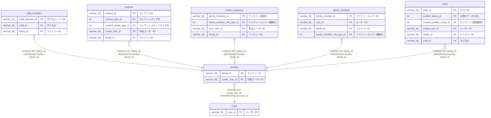

# families

## 概要

ファミリーTBL

<details>
<summary><strong>テーブル定義</strong></summary>

```sql
CREATE TABLE `families` (
  `family_id` varchar(36) NOT NULL COMMENT 'ファミリーID',
  `family_name` varchar(100) NOT NULL COMMENT 'ファミリー名',
  `create_user_id` varchar(36) NOT NULL COMMENT '作成ユーザーID',
  `created_at` datetime(6) NOT NULL COMMENT '作成日時',
  PRIMARY KEY (`family_id`),
  KEY `create_user_id` (`create_user_id`),
  CONSTRAINT `families_ibfk_1` FOREIGN KEY (`create_user_id`) REFERENCES `users` (`user_id`)
) ENGINE=InnoDB DEFAULT CHARSET=utf8mb4 COLLATE=utf8mb4_0900_ai_ci COMMENT='ファミリーTBL'
```

</details>

## カラム一覧

| 名前           | タイプ       | デフォルト値 | Nullable | 子テーブル                                                                                                                                                  | 親テーブル        | コメント       |
| -------------- | ------------ | ------------ | -------- | ----------------------------------------------------------------------------------------------------------------------------------------------------------- | ----------------- | -------------- |
| family_id      | varchar(36)  |              | false    | [child_members](child_members.md) [contents](contents.md) [family_invitations](family_invitations.md) [family_members](family_members.md) [posts](posts.md) |                   | ファミリーID   |
| family_name    | varchar(100) |              | false    |                                                                                                                                                             |                   | ファミリー名   |
| create_user_id | varchar(36)  |              | false    |                                                                                                                                                             | [users](users.md) | 作成ユーザーID |
| created_at     | datetime(6)  |              | false    |                                                                                                                                                             |                   | 作成日時       |

## 制約一覧

| 名前            | タイプ      | 定義                                                    |
| --------------- | ----------- | ------------------------------------------------------- |
| families_ibfk_1 | FOREIGN KEY | FOREIGN KEY (create_user_id) REFERENCES users (user_id) |
| PRIMARY         | PRIMARY KEY | PRIMARY KEY (family_id)                                 |

## INDEX一覧

| 名前           | 定義                                            |
| -------------- | ----------------------------------------------- |
| create_user_id | KEY create_user_id (create_user_id) USING BTREE |
| PRIMARY        | PRIMARY KEY (family_id) USING BTREE             |

## ER図



---

> Generated by [tbls](https://github.com/k1LoW/tbls)
