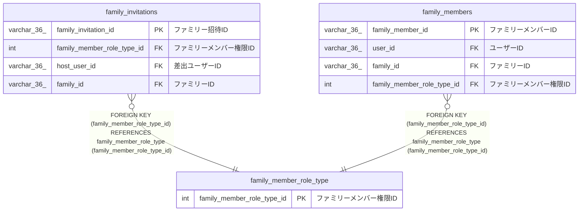

# family_member_role_type

## 概要

ファミリーメンバー権限マスターTBL

<details>
<summary><strong>テーブル定義</strong></summary>

```sql
CREATE TABLE `family_member_role_type` (
  `family_member_role_type_id` int NOT NULL AUTO_INCREMENT COMMENT 'ファミリーメンバー権限ID',
  `name` varchar(100) NOT NULL COMMENT '権限名',
  `display_name` varchar(100) NOT NULL COMMENT '権限表示名',
  `explanation` varchar(100) NOT NULL COMMENT '説明',
  PRIMARY KEY (`family_member_role_type_id`),
  UNIQUE KEY `name` (`name`),
  UNIQUE KEY `display_name` (`display_name`),
  UNIQUE KEY `explanation` (`explanation`)
) ENGINE=InnoDB AUTO_INCREMENT=[Redacted by tbls] DEFAULT CHARSET=utf8mb4 COLLATE=utf8mb4_0900_ai_ci COMMENT='ファミリーメンバー権限マスターTBL'
```

</details>

## カラム一覧

| 名前                       | タイプ       | デフォルト値 | Nullable | Extra Definition | 子テーブル                                                                      | 親テーブル | コメント                 |
| -------------------------- | ------------ | ------------ | -------- | ---------------- | ------------------------------------------------------------------------------- | ---------- | ------------------------ |
| family_member_role_type_id | int          |              | false    | auto_increment   | [family_invitations](family_invitations.md) [family_members](family_members.md) |            | ファミリーメンバー権限ID |
| name                       | varchar(100) |              | false    |                  |                                                                                 |            | 権限名                   |
| display_name               | varchar(100) |              | false    |                  |                                                                                 |            | 権限表示名               |
| explanation                | varchar(100) |              | false    |                  |                                                                                 |            | 説明                     |

## 制約一覧

| 名前         | タイプ      | 定義                                     |
| ------------ | ----------- | ---------------------------------------- |
| display_name | UNIQUE      | UNIQUE KEY display_name (display_name)   |
| explanation  | UNIQUE      | UNIQUE KEY explanation (explanation)     |
| name         | UNIQUE      | UNIQUE KEY name (name)                   |
| PRIMARY      | PRIMARY KEY | PRIMARY KEY (family_member_role_type_id) |

## INDEX一覧

| 名前         | 定義                                                 |
| ------------ | ---------------------------------------------------- |
| PRIMARY      | PRIMARY KEY (family_member_role_type_id) USING BTREE |
| display_name | UNIQUE KEY display_name (display_name) USING BTREE   |
| explanation  | UNIQUE KEY explanation (explanation) USING BTREE     |
| name         | UNIQUE KEY name (name) USING BTREE                   |

## ER図



---

> Generated by [tbls](https://github.com/k1LoW/tbls)
