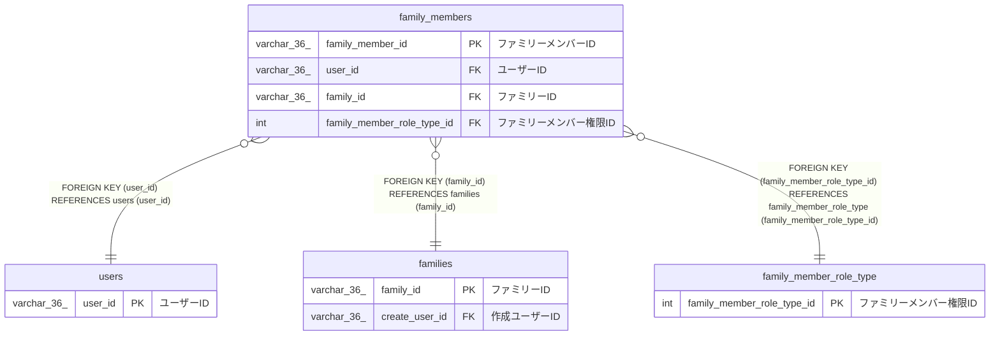

# family_members

## 概要

ファミリーメンバーTBL

<details>
<summary><strong>テーブル定義</strong></summary>

```sql
CREATE TABLE `family_members` (
  `family_member_id` varchar(36) NOT NULL COMMENT 'ファミリーメンバーID',
  `user_id` varchar(36) NOT NULL COMMENT 'ユーザーID',
  `nickname` varchar(100) NOT NULL COMMENT 'ニックネーム',
  `family_id` varchar(36) NOT NULL COMMENT 'ファミリーID',
  `family_member_role_type_id` int NOT NULL COMMENT 'ファミリーメンバー権限ID',
  `created_at` datetime(6) NOT NULL COMMENT '作成日時',
  PRIMARY KEY (`family_member_id`),
  KEY `user_id` (`user_id`),
  KEY `family_id` (`family_id`),
  KEY `family_member_role_type_id` (`family_member_role_type_id`),
  CONSTRAINT `family_members_ibfk_1` FOREIGN KEY (`user_id`) REFERENCES `users` (`user_id`),
  CONSTRAINT `family_members_ibfk_2` FOREIGN KEY (`family_id`) REFERENCES `families` (`family_id`),
  CONSTRAINT `family_members_ibfk_3` FOREIGN KEY (`family_member_role_type_id`) REFERENCES `family_member_role_type` (`family_member_role_type_id`)
) ENGINE=InnoDB DEFAULT CHARSET=utf8mb4 COLLATE=utf8mb4_0900_ai_ci COMMENT='ファミリーメンバーTBL'
```

</details>

## カラム一覧

| 名前                       | タイプ       | デフォルト値 | Nullable | 子テーブル | 親テーブル                                            | コメント                 |
| -------------------------- | ------------ | ------------ | -------- | ---------- | ----------------------------------------------------- | ------------------------ |
| family_member_id           | varchar(36)  |              | false    |            |                                                       | ファミリーメンバーID     |
| user_id                    | varchar(36)  |              | false    |            | [users](users.md)                                     | ユーザーID               |
| nickname                   | varchar(100) |              | false    |            |                                                       | ニックネーム             |
| family_id                  | varchar(36)  |              | false    |            | [families](families.md)                               | ファミリーID             |
| family_member_role_type_id | int          |              | false    |            | [family_member_role_type](family_member_role_type.md) | ファミリーメンバー権限ID |
| created_at                 | datetime(6)  |              | false    |            |                                                       | 作成日時                 |

## 制約一覧

| 名前                  | タイプ      | 定義                                                                                                     |
| --------------------- | ----------- | -------------------------------------------------------------------------------------------------------- |
| family_members_ibfk_1 | FOREIGN KEY | FOREIGN KEY (user_id) REFERENCES users (user_id)                                                         |
| family_members_ibfk_2 | FOREIGN KEY | FOREIGN KEY (family_id) REFERENCES families (family_id)                                                  |
| family_members_ibfk_3 | FOREIGN KEY | FOREIGN KEY (family_member_role_type_id) REFERENCES family_member_role_type (family_member_role_type_id) |
| PRIMARY               | PRIMARY KEY | PRIMARY KEY (family_member_id)                                                                           |

## INDEX一覧

| 名前                       | 定義                                                                    |
| -------------------------- | ----------------------------------------------------------------------- |
| family_id                  | KEY family_id (family_id) USING BTREE                                   |
| family_member_role_type_id | KEY family_member_role_type_id (family_member_role_type_id) USING BTREE |
| user_id                    | KEY user_id (user_id) USING BTREE                                       |
| PRIMARY                    | PRIMARY KEY (family_member_id) USING BTREE                              |

## ER図



---

> Generated by [tbls](https://github.com/k1LoW/tbls)
