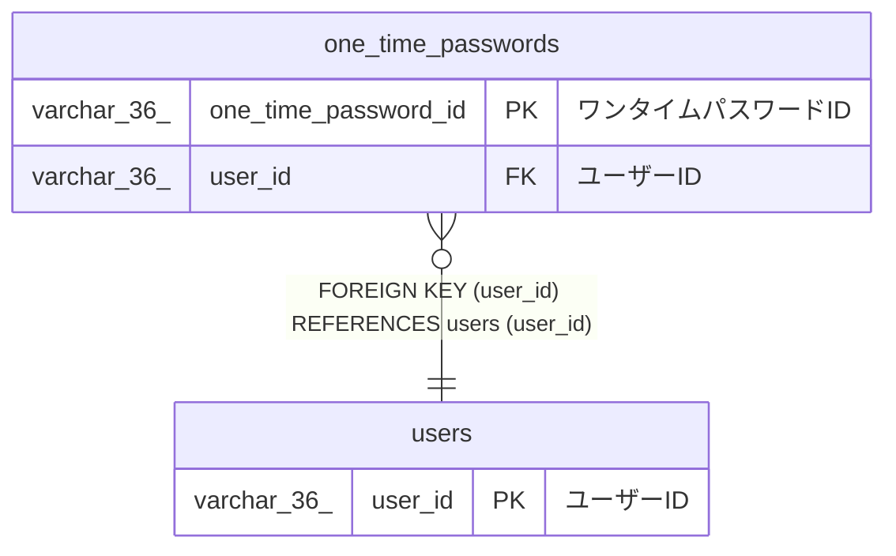

# one_time_passwords

## 概要

ワンタイムパスワードTBL

<details>
<summary><strong>テーブル定義</strong></summary>

```sql
CREATE TABLE `one_time_passwords` (
  `one_time_password_id` varchar(36) NOT NULL COMMENT 'ワンタイムパスワードID',
  `user_id` varchar(36) NOT NULL COMMENT 'ユーザーID',
  `encrypted_secret_key` varchar(255) NOT NULL COMMENT '暗号化済みシークレットキー',
  `created_at` datetime(6) NOT NULL COMMENT '作成日時',
  PRIMARY KEY (`one_time_password_id`),
  KEY `user_id` (`user_id`),
  CONSTRAINT `one_time_passwords_ibfk_1` FOREIGN KEY (`user_id`) REFERENCES `users` (`user_id`)
) ENGINE=InnoDB DEFAULT CHARSET=utf8mb4 COLLATE=utf8mb4_0900_ai_ci COMMENT='ワンタイムパスワードTBL'
```

</details>

## カラム一覧

| 名前                 | タイプ       | デフォルト値 | Nullable | 子テーブル | 親テーブル        | コメント                   |
| -------------------- | ------------ | ------------ | -------- | ---------- | ----------------- | -------------------------- |
| one_time_password_id | varchar(36)  |              | false    |            |                   | ワンタイムパスワードID     |
| user_id              | varchar(36)  |              | false    |            | [users](users.md) | ユーザーID                 |
| encrypted_secret_key | varchar(255) |              | false    |            |                   | 暗号化済みシークレットキー |
| created_at           | datetime(6)  |              | false    |            |                   | 作成日時                   |

## 制約一覧

| 名前                      | タイプ      | 定義                                             |
| ------------------------- | ----------- | ------------------------------------------------ |
| one_time_passwords_ibfk_1 | FOREIGN KEY | FOREIGN KEY (user_id) REFERENCES users (user_id) |
| PRIMARY                   | PRIMARY KEY | PRIMARY KEY (one_time_password_id)               |

## INDEX一覧

| 名前    | 定義                                           |
| ------- | ---------------------------------------------- |
| user_id | KEY user_id (user_id) USING BTREE              |
| PRIMARY | PRIMARY KEY (one_time_password_id) USING BTREE |

## ER図



---

> Generated by [tbls](https://github.com/k1LoW/tbls)
