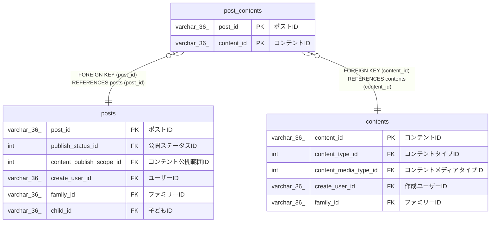

# post_contents

## 概要

ポストコンテンツTBL

<details>
<summary><strong>テーブル定義</strong></summary>

```sql
CREATE TABLE `post_contents` (
  `post_id` varchar(36) NOT NULL COMMENT 'ポストID',
  `content_id` varchar(36) NOT NULL COMMENT 'コンテントID',
  `created_at` datetime(6) NOT NULL COMMENT '作成日時',
  PRIMARY KEY (`post_id`,`content_id`),
  KEY `content_id` (`content_id`),
  CONSTRAINT `post_contents_ibfk_1` FOREIGN KEY (`post_id`) REFERENCES `posts` (`post_id`),
  CONSTRAINT `post_contents_ibfk_2` FOREIGN KEY (`content_id`) REFERENCES `contents` (`content_id`)
) ENGINE=InnoDB DEFAULT CHARSET=utf8mb4 COLLATE=utf8mb4_0900_ai_ci COMMENT='ポストコンテンツTBL'
```

</details>

## カラム一覧

| 名前       | タイプ      | デフォルト値 | Nullable | 子テーブル | 親テーブル              | コメント     |
| ---------- | ----------- | ------------ | -------- | ---------- | ----------------------- | ------------ |
| post_id    | varchar(36) |              | false    |            | [posts](posts.md)       | ポストID     |
| content_id | varchar(36) |              | false    |            | [contents](contents.md) | コンテントID |
| created_at | datetime(6) |              | false    |            |                         | 作成日時     |

## 制約一覧

| 名前                 | タイプ      | 定義                                                      |
| -------------------- | ----------- | --------------------------------------------------------- |
| post_contents_ibfk_1 | FOREIGN KEY | FOREIGN KEY (post_id) REFERENCES posts (post_id)          |
| post_contents_ibfk_2 | FOREIGN KEY | FOREIGN KEY (content_id) REFERENCES contents (content_id) |
| PRIMARY              | PRIMARY KEY | PRIMARY KEY (post_id, content_id)                         |

## INDEX一覧

| 名前       | 定義                                          |
| ---------- | --------------------------------------------- |
| content_id | KEY content_id (content_id) USING BTREE       |
| PRIMARY    | PRIMARY KEY (post_id, content_id) USING BTREE |

## ER図



---

> Generated by [tbls](https://github.com/k1LoW/tbls)
