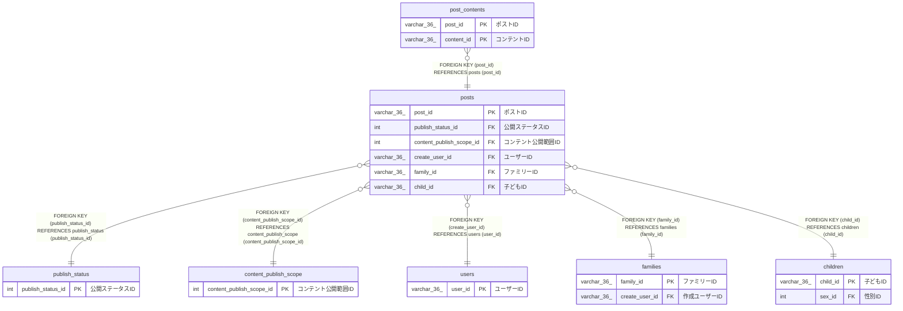

# posts

## 概要

コンテント投稿TBL

<details>
<summary><strong>テーブル定義</strong></summary>

```sql
CREATE TABLE `posts` (
  `post_id` varchar(36) NOT NULL COMMENT 'ポストID',
  `publish_status_id` int NOT NULL COMMENT '公開ステータスID',
  `content_publish_scope_id` int NOT NULL COMMENT 'コンテント公開範囲ID',
  `create_user_id` varchar(36) NOT NULL COMMENT 'ユーザーID',
  `family_id` varchar(36) NOT NULL COMMENT 'ファミリーID',
  `child_id` varchar(36) NOT NULL COMMENT '子どもID',
  `created_at` datetime(6) NOT NULL COMMENT '作成日時',
  PRIMARY KEY (`post_id`),
  KEY `publish_status_id` (`publish_status_id`),
  KEY `content_publish_scope_id` (`content_publish_scope_id`),
  KEY `create_user_id` (`create_user_id`),
  KEY `family_id` (`family_id`),
  KEY `child_id` (`child_id`),
  CONSTRAINT `posts_ibfk_1` FOREIGN KEY (`publish_status_id`) REFERENCES `publish_status` (`publish_status_id`),
  CONSTRAINT `posts_ibfk_3` FOREIGN KEY (`content_publish_scope_id`) REFERENCES `content_publish_scope` (`content_publish_scope_id`),
  CONSTRAINT `posts_ibfk_4` FOREIGN KEY (`create_user_id`) REFERENCES `users` (`user_id`),
  CONSTRAINT `posts_ibfk_5` FOREIGN KEY (`family_id`) REFERENCES `families` (`family_id`),
  CONSTRAINT `posts_ibfk_6` FOREIGN KEY (`child_id`) REFERENCES `children` (`child_id`)
) ENGINE=InnoDB DEFAULT CHARSET=utf8mb4 COLLATE=utf8mb4_0900_ai_ci COMMENT='コンテント投稿TBL'
```

</details>

## カラム一覧

| 名前                     | タイプ      | デフォルト値 | Nullable | 子テーブル                        | 親テーブル                                        | コメント             |
| ------------------------ | ----------- | ------------ | -------- | --------------------------------- | ------------------------------------------------- | -------------------- |
| post_id                  | varchar(36) |              | false    | [post_contents](post_contents.md) |                                                   | ポストID             |
| publish_status_id        | int         |              | false    |                                   | [publish_status](publish_status.md)               | 公開ステータスID     |
| content_publish_scope_id | int         |              | false    |                                   | [content_publish_scope](content_publish_scope.md) | コンテント公開範囲ID |
| create_user_id           | varchar(36) |              | false    |                                   | [users](users.md)                                 | ユーザーID           |
| family_id                | varchar(36) |              | false    |                                   | [families](families.md)                           | ファミリーID         |
| child_id                 | varchar(36) |              | false    |                                   | [children](children.md)                           | 子どもID             |
| created_at               | datetime(6) |              | false    |                                   |                                                   | 作成日時             |

## 制約一覧

| 名前         | タイプ      | 定義                                                                                               |
| ------------ | ----------- | -------------------------------------------------------------------------------------------------- |
| posts_ibfk_1 | FOREIGN KEY | FOREIGN KEY (publish_status_id) REFERENCES publish_status (publish_status_id)                      |
| posts_ibfk_3 | FOREIGN KEY | FOREIGN KEY (content_publish_scope_id) REFERENCES content_publish_scope (content_publish_scope_id) |
| posts_ibfk_4 | FOREIGN KEY | FOREIGN KEY (create_user_id) REFERENCES users (user_id)                                            |
| posts_ibfk_5 | FOREIGN KEY | FOREIGN KEY (family_id) REFERENCES families (family_id)                                            |
| posts_ibfk_6 | FOREIGN KEY | FOREIGN KEY (child_id) REFERENCES children (child_id)                                              |
| PRIMARY      | PRIMARY KEY | PRIMARY KEY (post_id)                                                                              |

## INDEX一覧

| 名前                     | 定義                                                                |
| ------------------------ | ------------------------------------------------------------------- |
| child_id                 | KEY child_id (child_id) USING BTREE                                 |
| content_publish_scope_id | KEY content_publish_scope_id (content_publish_scope_id) USING BTREE |
| create_user_id           | KEY create_user_id (create_user_id) USING BTREE                     |
| family_id                | KEY family_id (family_id) USING BTREE                               |
| publish_status_id        | KEY publish_status_id (publish_status_id) USING BTREE               |
| PRIMARY                  | PRIMARY KEY (post_id) USING BTREE                                   |

## ER図



---

> Generated by [tbls](https://github.com/k1LoW/tbls)
