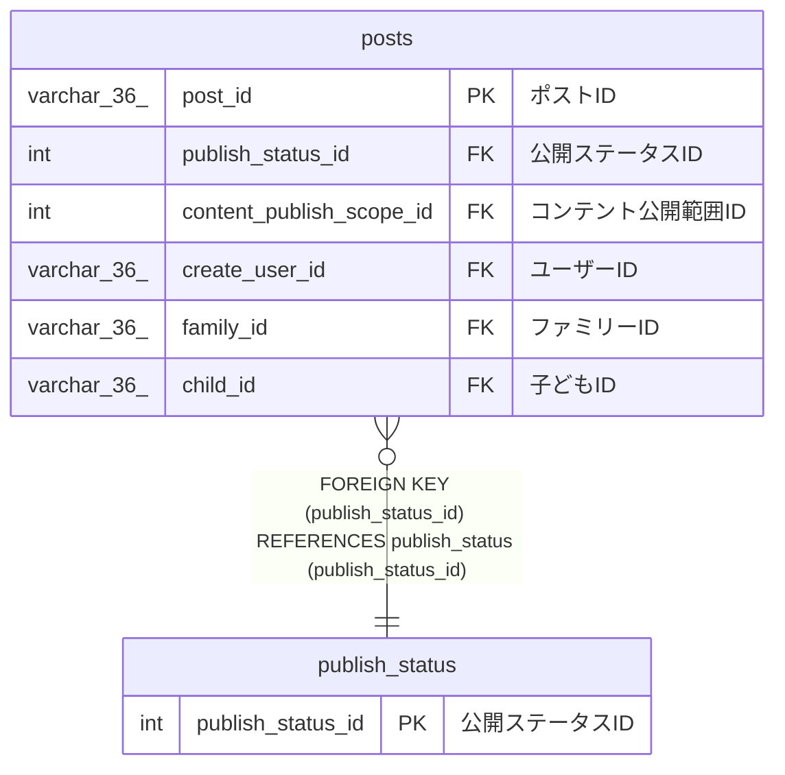

# publish_status

## 概要

公開ステータスマスターTBL

<details>
<summary><strong>テーブル定義</strong></summary>

```sql
CREATE TABLE `publish_status` (
  `publish_status_id` int NOT NULL COMMENT '公開ステータスID',
  `publish_status_name` varchar(100) NOT NULL COMMENT '公開ステータス名',
  `explanation` varchar(100) NOT NULL COMMENT '説明',
  PRIMARY KEY (`publish_status_id`),
  UNIQUE KEY `explanation` (`explanation`)
) ENGINE=InnoDB DEFAULT CHARSET=utf8mb4 COLLATE=utf8mb4_0900_ai_ci COMMENT='公開ステータスマスターTBL'
```

</details>

## カラム一覧

| 名前                | タイプ       | デフォルト値 | Nullable | 子テーブル        | 親テーブル | コメント         |
| ------------------- | ------------ | ------------ | -------- | ----------------- | ---------- | ---------------- |
| publish_status_id   | int          |              | false    | [posts](posts.md) |            | 公開ステータスID |
| publish_status_name | varchar(100) |              | false    |                   |            | 公開ステータス名 |
| explanation         | varchar(100) |              | false    |                   |            | 説明             |

## 制約一覧

| 名前        | タイプ      | 定義                                 |
| ----------- | ----------- | ------------------------------------ |
| explanation | UNIQUE      | UNIQUE KEY explanation (explanation) |
| PRIMARY     | PRIMARY KEY | PRIMARY KEY (publish_status_id)      |

## INDEX一覧

| 名前        | 定義                                             |
| ----------- | ------------------------------------------------ |
| PRIMARY     | PRIMARY KEY (publish_status_id) USING BTREE      |
| explanation | UNIQUE KEY explanation (explanation) USING BTREE |

## ER図



---

> Generated by [tbls](https://github.com/k1LoW/tbls)
