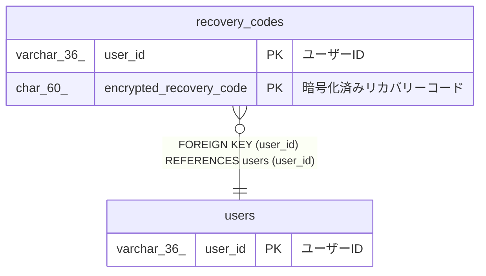

# recovery_codes

## 概要

リカバリーコードTBL

<details>
<summary><strong>テーブル定義</strong></summary>

```sql
CREATE TABLE `recovery_codes` (
  `user_id` varchar(36) NOT NULL COMMENT 'ユーザーID',
  `encrypted_recovery_code` char(60) NOT NULL COMMENT '暗号化済みリカバリーコード',
  `created_at` datetime(6) NOT NULL COMMENT '作成日時',
  PRIMARY KEY (`user_id`,`encrypted_recovery_code`),
  CONSTRAINT `recovery_codes_ibfk_1` FOREIGN KEY (`user_id`) REFERENCES `users` (`user_id`)
) ENGINE=InnoDB DEFAULT CHARSET=utf8mb4 COLLATE=utf8mb4_0900_ai_ci COMMENT='リカバリーコードTBL'
```

</details>

## カラム一覧

| 名前                    | タイプ      | デフォルト値 | Nullable | 子テーブル | 親テーブル        | コメント                   |
| ----------------------- | ----------- | ------------ | -------- | ---------- | ----------------- | -------------------------- |
| user_id                 | varchar(36) |              | false    |            | [users](users.md) | ユーザーID                 |
| encrypted_recovery_code | char(60)    |              | false    |            |                   | 暗号化済みリカバリーコード |
| created_at              | datetime(6) |              | false    |            |                   | 作成日時                   |

## 制約一覧

| 名前                  | タイプ      | 定義                                             |
| --------------------- | ----------- | ------------------------------------------------ |
| PRIMARY               | PRIMARY KEY | PRIMARY KEY (user_id, encrypted_recovery_code)   |
| recovery_codes_ibfk_1 | FOREIGN KEY | FOREIGN KEY (user_id) REFERENCES users (user_id) |

## INDEX一覧

| 名前    | 定義                                                       |
| ------- | ---------------------------------------------------------- |
| PRIMARY | PRIMARY KEY (user_id, encrypted_recovery_code) USING BTREE |

## ER図



---

> Generated by [tbls](https://github.com/k1LoW/tbls)
