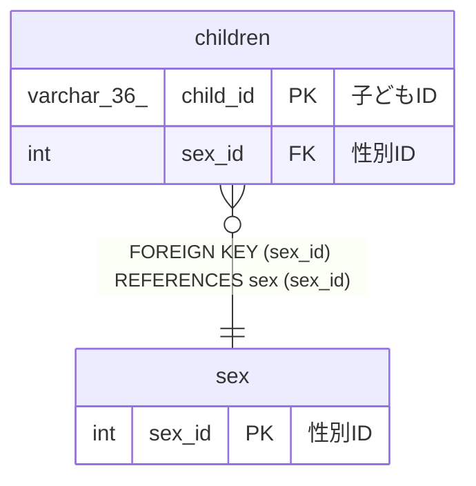

# sex

## 概要

性別マスターTBL

<details>
<summary><strong>テーブル定義</strong></summary>

```sql
CREATE TABLE `sex` (
  `sex_id` int NOT NULL AUTO_INCREMENT COMMENT '性別ID',
  `name` varchar(100) NOT NULL COMMENT '性別名',
  `explanation` varchar(100) NOT NULL COMMENT '説明',
  PRIMARY KEY (`sex_id`),
  UNIQUE KEY `name` (`name`),
  UNIQUE KEY `explanation` (`explanation`)
) ENGINE=InnoDB AUTO_INCREMENT=[Redacted by tbls] DEFAULT CHARSET=utf8mb4 COLLATE=utf8mb4_0900_ai_ci COMMENT='性別マスターTBL'
```

</details>

## カラム一覧

| 名前        | タイプ       | デフォルト値 | Nullable | Extra Definition | 子テーブル              | 親テーブル | コメント |
| ----------- | ------------ | ------------ | -------- | ---------------- | ----------------------- | ---------- | -------- |
| sex_id      | int          |              | false    | auto_increment   | [children](children.md) |            | 性別ID   |
| name        | varchar(100) |              | false    |                  |                         |            | 性別名   |
| explanation | varchar(100) |              | false    |                  |                         |            | 説明     |

## 制約一覧

| 名前        | タイプ      | 定義                                 |
| ----------- | ----------- | ------------------------------------ |
| explanation | UNIQUE      | UNIQUE KEY explanation (explanation) |
| name        | UNIQUE      | UNIQUE KEY name (name)               |
| PRIMARY     | PRIMARY KEY | PRIMARY KEY (sex_id)                 |

## INDEX一覧

| 名前        | 定義                                             |
| ----------- | ------------------------------------------------ |
| PRIMARY     | PRIMARY KEY (sex_id) USING BTREE                 |
| explanation | UNIQUE KEY explanation (explanation) USING BTREE |
| name        | UNIQUE KEY name (name) USING BTREE               |

## ER図



---

> Generated by [tbls](https://github.com/k1LoW/tbls)
