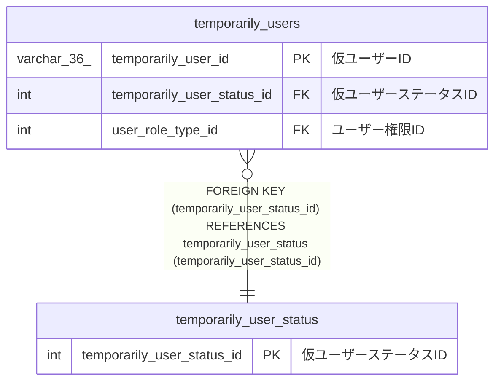

# temporarily_user_status

## 概要

仮ユーザーステータスマスターTBl

<details>
<summary><strong>テーブル定義</strong></summary>

```sql
CREATE TABLE `temporarily_user_status` (
  `temporarily_user_status_id` int NOT NULL AUTO_INCREMENT COMMENT '仮ユーザーステータスID',
  `name` varchar(100) NOT NULL COMMENT 'ステータス名',
  `explanation` varchar(100) NOT NULL COMMENT '説明',
  PRIMARY KEY (`temporarily_user_status_id`),
  UNIQUE KEY `name` (`name`),
  UNIQUE KEY `explanation` (`explanation`)
) ENGINE=InnoDB AUTO_INCREMENT=[Redacted by tbls] DEFAULT CHARSET=utf8mb4 COLLATE=utf8mb4_0900_ai_ci COMMENT='仮ユーザーステータスマスターTBl'
```

</details>

## カラム一覧

| 名前                       | タイプ       | デフォルト値 | Nullable | Extra Definition | 子テーブル                                | 親テーブル | コメント               |
| -------------------------- | ------------ | ------------ | -------- | ---------------- | ----------------------------------------- | ---------- | ---------------------- |
| temporarily_user_status_id | int          |              | false    | auto_increment   | [temporarily_users](temporarily_users.md) |            | 仮ユーザーステータスID |
| name                       | varchar(100) |              | false    |                  |                                           |            | ステータス名           |
| explanation                | varchar(100) |              | false    |                  |                                           |            | 説明                   |

## 制約一覧

| 名前        | タイプ      | 定義                                     |
| ----------- | ----------- | ---------------------------------------- |
| explanation | UNIQUE      | UNIQUE KEY explanation (explanation)     |
| name        | UNIQUE      | UNIQUE KEY name (name)                   |
| PRIMARY     | PRIMARY KEY | PRIMARY KEY (temporarily_user_status_id) |

## INDEX一覧

| 名前        | 定義                                                 |
| ----------- | ---------------------------------------------------- |
| PRIMARY     | PRIMARY KEY (temporarily_user_status_id) USING BTREE |
| explanation | UNIQUE KEY explanation (explanation) USING BTREE     |
| name        | UNIQUE KEY name (name) USING BTREE                   |

## ER図



---

> Generated by [tbls](https://github.com/k1LoW/tbls)
