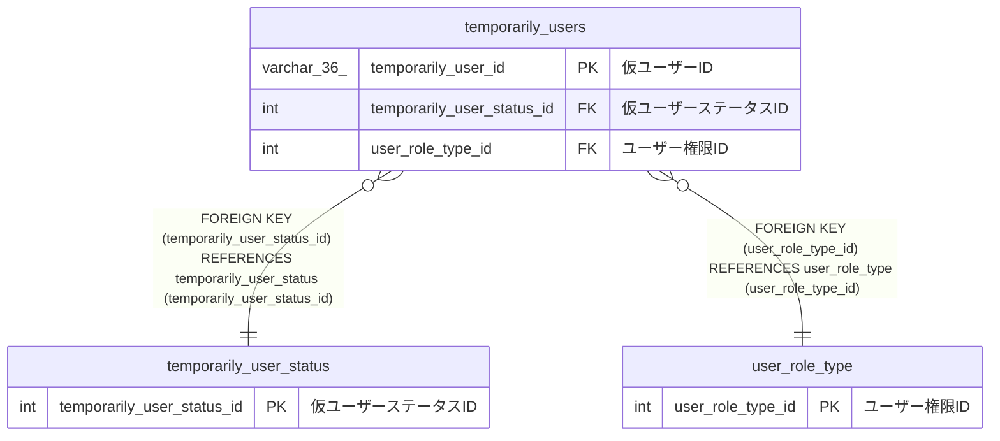

# temporarily_users

## 概要

仮ユーザーTBL

<details>
<summary><strong>テーブル定義</strong></summary>

```sql
CREATE TABLE `temporarily_users` (
  `temporarily_user_id` varchar(36) NOT NULL COMMENT '仮ユーザーID',
  `temporarily_user_status_id` int NOT NULL COMMENT '仮ユーザーステータスID',
  `user_id` varchar(36) NOT NULL COMMENT 'ユーザーID',
  `email` varchar(255) NOT NULL COMMENT 'メールアドレス',
  `user_role_type_id` int NOT NULL COMMENT 'ユーザー権限ID',
  `password` varchar(100) NOT NULL COMMENT 'パスワード',
  `activate_token` varchar(255) NOT NULL COMMENT 'アクティベートトークン',
  `expiration_date` datetime(6) NOT NULL COMMENT '有効期限',
  `created_at` datetime(6) NOT NULL COMMENT '作成日時',
  PRIMARY KEY (`temporarily_user_id`),
  KEY `temporarily_user_status_id` (`temporarily_user_status_id`),
  KEY `user_role_type_id` (`user_role_type_id`),
  CONSTRAINT `temporarily_users_ibfk_1` FOREIGN KEY (`temporarily_user_status_id`) REFERENCES `temporarily_user_status` (`temporarily_user_status_id`),
  CONSTRAINT `temporarily_users_ibfk_2` FOREIGN KEY (`user_role_type_id`) REFERENCES `user_role_type` (`user_role_type_id`)
) ENGINE=InnoDB DEFAULT CHARSET=utf8mb4 COLLATE=utf8mb4_0900_ai_ci COMMENT='仮ユーザーTBL'
```

</details>

## カラム一覧

| 名前                       | タイプ       | デフォルト値 | Nullable | 子テーブル | 親テーブル                                            | コメント               |
| -------------------------- | ------------ | ------------ | -------- | ---------- | ----------------------------------------------------- | ---------------------- |
| temporarily_user_id        | varchar(36)  |              | false    |            |                                                       | 仮ユーザーID           |
| temporarily_user_status_id | int          |              | false    |            | [temporarily_user_status](temporarily_user_status.md) | 仮ユーザーステータスID |
| user_id                    | varchar(36)  |              | false    |            |                                                       | ユーザーID             |
| email                      | varchar(255) |              | false    |            |                                                       | メールアドレス         |
| user_role_type_id          | int          |              | false    |            | [user_role_type](user_role_type.md)                   | ユーザー権限ID         |
| password                   | varchar(100) |              | false    |            |                                                       | パスワード             |
| activate_token             | varchar(255) |              | false    |            |                                                       | アクティベートトークン |
| expiration_date            | datetime(6)  |              | false    |            |                                                       | 有効期限               |
| created_at                 | datetime(6)  |              | false    |            |                                                       | 作成日時               |

## 制約一覧

| 名前                     | タイプ      | 定義                                                                                                     |
| ------------------------ | ----------- | -------------------------------------------------------------------------------------------------------- |
| PRIMARY                  | PRIMARY KEY | PRIMARY KEY (temporarily_user_id)                                                                        |
| temporarily_users_ibfk_1 | FOREIGN KEY | FOREIGN KEY (temporarily_user_status_id) REFERENCES temporarily_user_status (temporarily_user_status_id) |
| temporarily_users_ibfk_2 | FOREIGN KEY | FOREIGN KEY (user_role_type_id) REFERENCES user_role_type (user_role_type_id)                            |

## INDEX一覧

| 名前                       | 定義                                                                    |
| -------------------------- | ----------------------------------------------------------------------- |
| temporarily_user_status_id | KEY temporarily_user_status_id (temporarily_user_status_id) USING BTREE |
| user_role_type_id          | KEY user_role_type_id (user_role_type_id) USING BTREE                   |
| PRIMARY                    | PRIMARY KEY (temporarily_user_id) USING BTREE                           |

## ER図



---

> Generated by [tbls](https://github.com/k1LoW/tbls)
