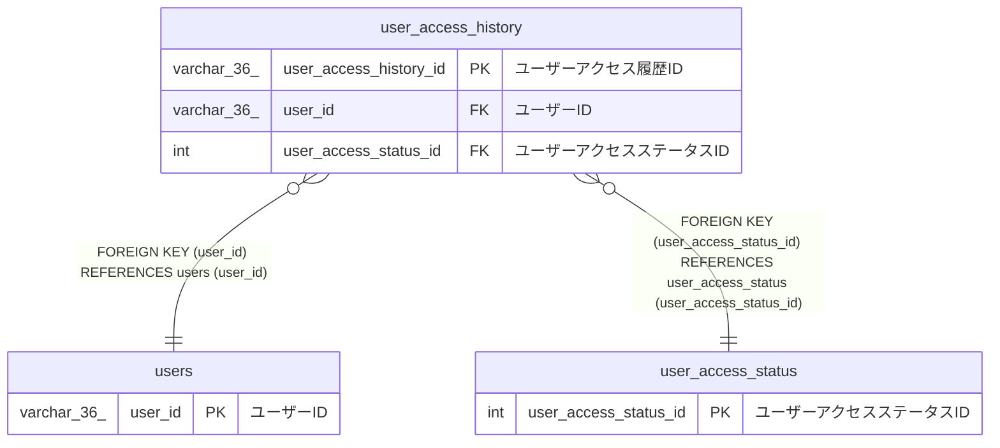

# user_access_history

## 概要

ユーザーログイン履歴TBL

<details>
<summary><strong>テーブル定義</strong></summary>

```sql
CREATE TABLE `user_access_history` (
  `user_access_history_id` varchar(36) NOT NULL COMMENT 'ユーザーアクセス履歴ID',
  `user_id` varchar(36) NOT NULL COMMENT 'ユーザーID',
  `user_access_status_id` int NOT NULL COMMENT 'ユーザーアクセスステータスID',
  `created_at` datetime(6) NOT NULL COMMENT '作成日時',
  PRIMARY KEY (`user_access_history_id`),
  KEY `user_id` (`user_id`),
  KEY `user_access_status_id` (`user_access_status_id`),
  CONSTRAINT `user_access_history_ibfk_1` FOREIGN KEY (`user_id`) REFERENCES `users` (`user_id`),
  CONSTRAINT `user_access_history_ibfk_2` FOREIGN KEY (`user_access_status_id`) REFERENCES `user_access_status` (`user_access_status_id`)
) ENGINE=InnoDB DEFAULT CHARSET=utf8mb4 COLLATE=utf8mb4_0900_ai_ci COMMENT='ユーザーログイン履歴TBL'
```

</details>

## カラム一覧

| 名前                   | タイプ      | デフォルト値 | Nullable | 子テーブル | 親テーブル                                  | コメント                     |
| ---------------------- | ----------- | ------------ | -------- | ---------- | ------------------------------------------- | ---------------------------- |
| user_access_history_id | varchar(36) |              | false    |            |                                             | ユーザーアクセス履歴ID       |
| user_id                | varchar(36) |              | false    |            | [users](users.md)                           | ユーザーID                   |
| user_access_status_id  | int         |              | false    |            | [user_access_status](user_access_status.md) | ユーザーアクセスステータスID |
| created_at             | datetime(6) |              | false    |            |                                             | 作成日時                     |

## 制約一覧

| 名前                       | タイプ      | 定義                                                                                      |
| -------------------------- | ----------- | ----------------------------------------------------------------------------------------- |
| PRIMARY                    | PRIMARY KEY | PRIMARY KEY (user_access_history_id)                                                      |
| user_access_history_ibfk_1 | FOREIGN KEY | FOREIGN KEY (user_id) REFERENCES users (user_id)                                          |
| user_access_history_ibfk_2 | FOREIGN KEY | FOREIGN KEY (user_access_status_id) REFERENCES user_access_status (user_access_status_id) |

## INDEX一覧

| 名前                  | 定義                                                          |
| --------------------- | ------------------------------------------------------------- |
| user_access_status_id | KEY user_access_status_id (user_access_status_id) USING BTREE |
| user_id               | KEY user_id (user_id) USING BTREE                             |
| PRIMARY               | PRIMARY KEY (user_access_history_id) USING BTREE              |

## ER図



---

> Generated by [tbls](https://github.com/k1LoW/tbls)
