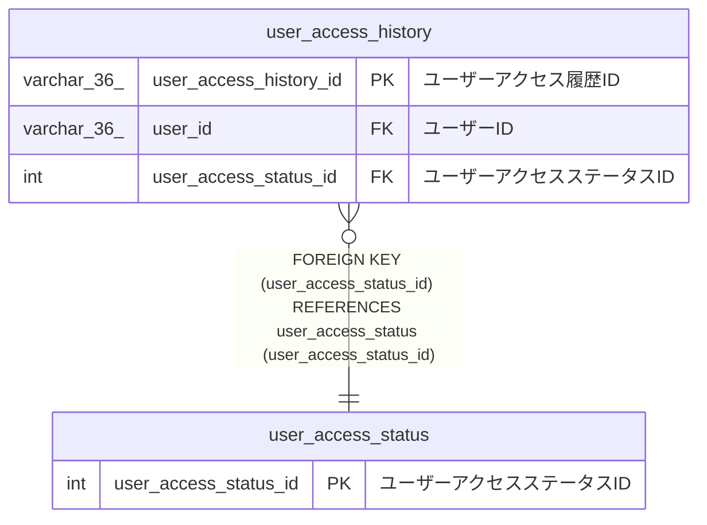

# user_access_status

## 概要

ユーザーアクセスステータスマスターTBL

<details>
<summary><strong>テーブル定義</strong></summary>

```sql
CREATE TABLE `user_access_status` (
  `user_access_status_id` int NOT NULL AUTO_INCREMENT COMMENT 'ユーザーアクセスステータスID',
  `name` varchar(20) NOT NULL COMMENT 'ステータス',
  `explanation` varchar(100) NOT NULL COMMENT '説明',
  PRIMARY KEY (`user_access_status_id`),
  UNIQUE KEY `explanation` (`explanation`)
) ENGINE=InnoDB AUTO_INCREMENT=[Redacted by tbls] DEFAULT CHARSET=utf8mb4 COLLATE=utf8mb4_0900_ai_ci COMMENT='ユーザーアクセスステータスマスターTBL'
```

</details>

## カラム一覧

| 名前                  | タイプ       | デフォルト値 | Nullable | Extra Definition | 子テーブル                                    | 親テーブル | コメント                     |
| --------------------- | ------------ | ------------ | -------- | ---------------- | --------------------------------------------- | ---------- | ---------------------------- |
| user_access_status_id | int          |              | false    | auto_increment   | [user_access_history](user_access_history.md) |            | ユーザーアクセスステータスID |
| name                  | varchar(20)  |              | false    |                  |                                               |            | ステータス                   |
| explanation           | varchar(100) |              | false    |                  |                                               |            | 説明                         |

## 制約一覧

| 名前        | タイプ      | 定義                                 |
| ----------- | ----------- | ------------------------------------ |
| explanation | UNIQUE      | UNIQUE KEY explanation (explanation) |
| PRIMARY     | PRIMARY KEY | PRIMARY KEY (user_access_status_id)  |

## INDEX一覧

| 名前        | 定義                                             |
| ----------- | ------------------------------------------------ |
| PRIMARY     | PRIMARY KEY (user_access_status_id) USING BTREE  |
| explanation | UNIQUE KEY explanation (explanation) USING BTREE |

## ER図



---

> Generated by [tbls](https://github.com/k1LoW/tbls)
