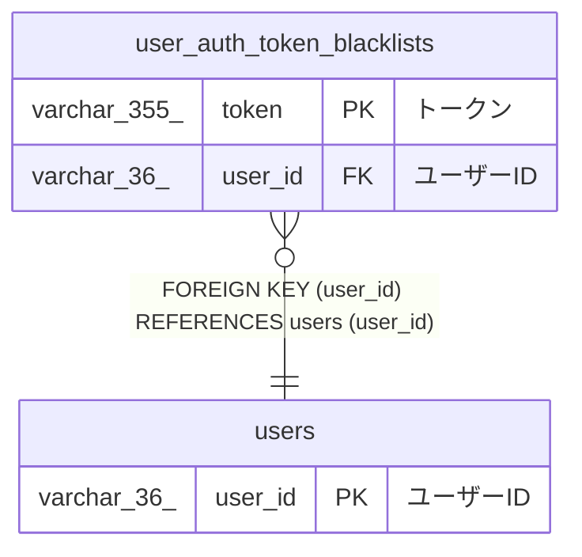

# user_auth_token_blacklists

## 概要

ユーザー認証トークンブラックリストTBL

<details>
<summary><strong>テーブル定義</strong></summary>

```sql
CREATE TABLE `user_auth_token_blacklists` (
  `token` varchar(355) NOT NULL COMMENT 'トークン',
  `user_id` varchar(36) NOT NULL COMMENT 'ユーザーID',
  `created_at` datetime(6) NOT NULL COMMENT '作成日時',
  PRIMARY KEY (`token`),
  UNIQUE KEY `token` (`token`),
  KEY `user_id` (`user_id`),
  CONSTRAINT `user_auth_token_blacklists_ibfk_1` FOREIGN KEY (`user_id`) REFERENCES `users` (`user_id`)
) ENGINE=InnoDB DEFAULT CHARSET=utf8mb4 COLLATE=utf8mb4_0900_ai_ci COMMENT='ユーザー認証トークンブラックリストTBL'
```

</details>

## カラム一覧

| 名前       | タイプ       | デフォルト値 | Nullable | 子テーブル | 親テーブル        | コメント   |
| ---------- | ------------ | ------------ | -------- | ---------- | ----------------- | ---------- |
| token      | varchar(355) |              | false    |            |                   | トークン   |
| user_id    | varchar(36)  |              | false    |            | [users](users.md) | ユーザーID |
| created_at | datetime(6)  |              | false    |            |                   | 作成日時   |

## 制約一覧

| 名前                              | タイプ      | 定義                                             |
| --------------------------------- | ----------- | ------------------------------------------------ |
| PRIMARY                           | PRIMARY KEY | PRIMARY KEY (token)                              |
| token                             | UNIQUE      | UNIQUE KEY token (token)                         |
| user_auth_token_blacklists_ibfk_1 | FOREIGN KEY | FOREIGN KEY (user_id) REFERENCES users (user_id) |

## INDEX一覧

| 名前    | 定義                                 |
| ------- | ------------------------------------ |
| user_id | KEY user_id (user_id) USING BTREE    |
| PRIMARY | PRIMARY KEY (token) USING BTREE      |
| token   | UNIQUE KEY token (token) USING BTREE |

## ER図



---

> Generated by [tbls](https://github.com/k1LoW/tbls)
