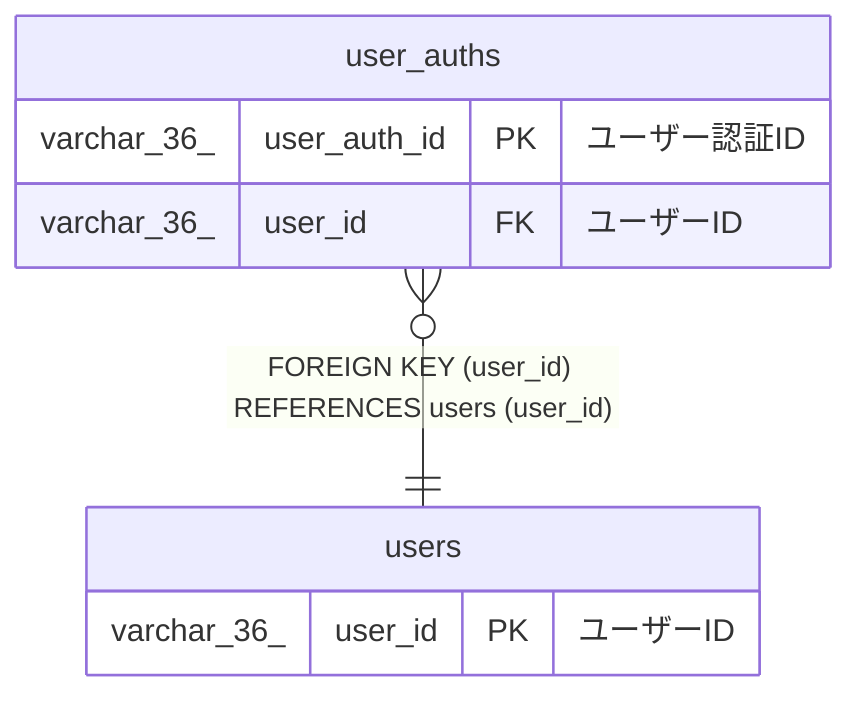

# user_auths

## 概要

ユーザー認証TBL

<details>
<summary><strong>テーブル定義</strong></summary>

```sql
CREATE TABLE `user_auths` (
  `user_auth_id` varchar(36) NOT NULL COMMENT 'ユーザー認証ID',
  `user_id` varchar(36) NOT NULL COMMENT 'ユーザーID',
  `password` varchar(100) NOT NULL COMMENT 'パスワード',
  `login_failure_count` int NOT NULL COMMENT 'ログイン失敗回数',
  `created_at` datetime(6) NOT NULL COMMENT '作成日時',
  PRIMARY KEY (`user_auth_id`),
  KEY `user_id` (`user_id`),
  CONSTRAINT `user_auths_ibfk_1` FOREIGN KEY (`user_id`) REFERENCES `users` (`user_id`)
) ENGINE=InnoDB DEFAULT CHARSET=utf8mb4 COLLATE=utf8mb4_0900_ai_ci COMMENT='ユーザー認証TBL'
```

</details>

## カラム一覧

| 名前                | タイプ       | デフォルト値 | Nullable | 子テーブル | 親テーブル        | コメント         |
| ------------------- | ------------ | ------------ | -------- | ---------- | ----------------- | ---------------- |
| user_auth_id        | varchar(36)  |              | false    |            |                   | ユーザー認証ID   |
| user_id             | varchar(36)  |              | false    |            | [users](users.md) | ユーザーID       |
| password            | varchar(100) |              | false    |            |                   | パスワード       |
| login_failure_count | int          |              | false    |            |                   | ログイン失敗回数 |
| created_at          | datetime(6)  |              | false    |            |                   | 作成日時         |

## 制約一覧

| 名前              | タイプ      | 定義                                             |
| ----------------- | ----------- | ------------------------------------------------ |
| PRIMARY           | PRIMARY KEY | PRIMARY KEY (user_auth_id)                       |
| user_auths_ibfk_1 | FOREIGN KEY | FOREIGN KEY (user_id) REFERENCES users (user_id) |

## INDEX一覧

| 名前    | 定義                                   |
| ------- | -------------------------------------- |
| user_id | KEY user_id (user_id) USING BTREE      |
| PRIMARY | PRIMARY KEY (user_auth_id) USING BTREE |

## ER図



---

> Generated by [tbls](https://github.com/k1LoW/tbls)
