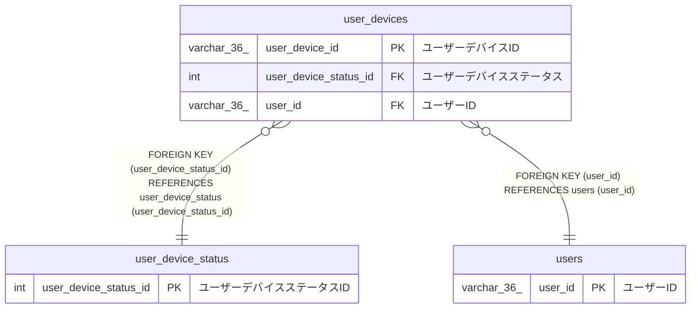

# user_devices

## 概要

ユーザーデバイスTBL

<details>
<summary><strong>テーブル定義</strong></summary>

```sql
CREATE TABLE `user_devices` (
  `user_device_id` varchar(36) NOT NULL COMMENT 'ユーザーデバイスID',
  `user_device_status_id` int NOT NULL COMMENT 'ユーザーデバイスステータス',
  `user_agent` varchar(1024) NOT NULL COMMENT 'ユーザーエージェント',
  `user_id` varchar(36) NOT NULL COMMENT 'ユーザーID',
  `created_at` datetime(6) NOT NULL COMMENT '作成日時',
  PRIMARY KEY (`user_device_id`),
  KEY `user_device_status_id` (`user_device_status_id`),
  KEY `user_id` (`user_id`),
  CONSTRAINT `user_devices_ibfk_1` FOREIGN KEY (`user_device_status_id`) REFERENCES `user_device_status` (`user_device_status_id`),
  CONSTRAINT `user_devices_ibfk_2` FOREIGN KEY (`user_id`) REFERENCES `users` (`user_id`)
) ENGINE=InnoDB DEFAULT CHARSET=utf8mb4 COLLATE=utf8mb4_0900_ai_ci COMMENT='ユーザーデバイスTBL'
```

</details>

## カラム一覧

| 名前                  | タイプ        | デフォルト値 | Nullable | 子テーブル | 親テーブル                                  | コメント                   |
| --------------------- | ------------- | ------------ | -------- | ---------- | ------------------------------------------- | -------------------------- |
| user_device_id        | varchar(36)   |              | false    |            |                                             | ユーザーデバイスID         |
| user_device_status_id | int           |              | false    |            | [user_device_status](user_device_status.md) | ユーザーデバイスステータス |
| user_agent            | varchar(1024) |              | false    |            |                                             | ユーザーエージェント       |
| user_id               | varchar(36)   |              | false    |            | [users](users.md)                           | ユーザーID                 |
| created_at            | datetime(6)   |              | false    |            |                                             | 作成日時                   |

## 制約一覧

| 名前                | タイプ      | 定義                                                                                      |
| ------------------- | ----------- | ----------------------------------------------------------------------------------------- |
| PRIMARY             | PRIMARY KEY | PRIMARY KEY (user_device_id)                                                              |
| user_devices_ibfk_1 | FOREIGN KEY | FOREIGN KEY (user_device_status_id) REFERENCES user_device_status (user_device_status_id) |
| user_devices_ibfk_2 | FOREIGN KEY | FOREIGN KEY (user_id) REFERENCES users (user_id)                                          |

## INDEX一覧

| 名前                  | 定義                                                          |
| --------------------- | ------------------------------------------------------------- |
| user_device_status_id | KEY user_device_status_id (user_device_status_id) USING BTREE |
| user_id               | KEY user_id (user_id) USING BTREE                             |
| PRIMARY               | PRIMARY KEY (user_device_id) USING BTREE                      |

## ER図



---

> Generated by [tbls](https://github.com/k1LoW/tbls)
