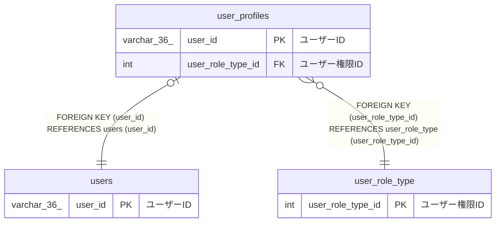

# user_profiles

## 概要

ユーザープロフィールTBL

<details>
<summary><strong>テーブル定義</strong></summary>

```sql
CREATE TABLE `user_profiles` (
  `user_id` varchar(36) NOT NULL COMMENT 'ユーザーID',
  `email` varchar(255) NOT NULL COMMENT 'メールアドレス',
  `user_role_type_id` int NOT NULL COMMENT 'ユーザー権限ID',
  `created_at` datetime(6) NOT NULL COMMENT '作成日時',
  PRIMARY KEY (`user_id`),
  UNIQUE KEY `email` (`email`),
  KEY `user_role_type_id` (`user_role_type_id`),
  CONSTRAINT `user_profiles_ibfk_1` FOREIGN KEY (`user_id`) REFERENCES `users` (`user_id`),
  CONSTRAINT `user_profiles_ibfk_2` FOREIGN KEY (`user_role_type_id`) REFERENCES `user_role_type` (`user_role_type_id`)
) ENGINE=InnoDB DEFAULT CHARSET=utf8mb4 COLLATE=utf8mb4_0900_ai_ci COMMENT='ユーザープロフィールTBL'
```

</details>

## カラム一覧

| 名前              | タイプ       | デフォルト値 | Nullable | 子テーブル | 親テーブル                          | コメント       |
| ----------------- | ------------ | ------------ | -------- | ---------- | ----------------------------------- | -------------- |
| user_id           | varchar(36)  |              | false    |            | [users](users.md)                   | ユーザーID     |
| email             | varchar(255) |              | false    |            |                                     | メールアドレス |
| user_role_type_id | int          |              | false    |            | [user_role_type](user_role_type.md) | ユーザー権限ID |
| created_at        | datetime(6)  |              | false    |            |                                     | 作成日時       |

## 制約一覧

| 名前                 | タイプ      | 定義                                                                          |
| -------------------- | ----------- | ----------------------------------------------------------------------------- |
| email                | UNIQUE      | UNIQUE KEY email (email)                                                      |
| PRIMARY              | PRIMARY KEY | PRIMARY KEY (user_id)                                                         |
| user_profiles_ibfk_1 | FOREIGN KEY | FOREIGN KEY (user_id) REFERENCES users (user_id)                              |
| user_profiles_ibfk_2 | FOREIGN KEY | FOREIGN KEY (user_role_type_id) REFERENCES user_role_type (user_role_type_id) |

## INDEX一覧

| 名前              | 定義                                                  |
| ----------------- | ----------------------------------------------------- |
| user_role_type_id | KEY user_role_type_id (user_role_type_id) USING BTREE |
| PRIMARY           | PRIMARY KEY (user_id) USING BTREE                     |
| email             | UNIQUE KEY email (email) USING BTREE                  |

## ER図



---

> Generated by [tbls](https://github.com/k1LoW/tbls)
