# users

## 概要

ユーザー情報TBL

<details>
<summary><strong>テーブル定義</strong></summary>

```sql
CREATE TABLE `users` (
  `user_id` varchar(36) NOT NULL COMMENT 'ユーザーID',
  `created_at` datetime(6) NOT NULL COMMENT '作成日時',
  PRIMARY KEY (`user_id`)
) ENGINE=InnoDB DEFAULT CHARSET=utf8mb4 COLLATE=utf8mb4_0900_ai_ci COMMENT='ユーザー情報TBL'
```

</details>

## カラム一覧

| 名前       | タイプ      | デフォルト値 | Nullable | 子テーブル                                                                                                                                                                                                                                                                                                                                                                                                                                                                            | 親テーブル | コメント   |
| ---------- | ----------- | ------------ | -------- | ------------------------------------------------------------------------------------------------------------------------------------------------------------------------------------------------------------------------------------------------------------------------------------------------------------------------------------------------------------------------------------------------------------------------------------------------------------------------------------- | ---------- | ---------- |
| user_id    | varchar(36) |              | false    | [content_blacklists](content_blacklists.md) [contents](contents.md) [families](families.md) [family_invitations](family_invitations.md) [family_members](family_members.md) [one_time_passwords](one_time_passwords.md) [posts](posts.md) [recovery_codes](recovery_codes.md) [user_access_history](user_access_history.md) [user_auth_token_blacklists](user_auth_token_blacklists.md) [user_auths](user_auths.md) [user_devices](user_devices.md) [user_profiles](user_profiles.md) |            | ユーザーID |
| created_at | datetime(6) |              | false    |                                                                                                                                                                                                                                                                                                                                                                                                                                                                                       |            | 作成日時   |

## 制約一覧

| 名前    | タイプ      | 定義                  |
| ------- | ----------- | --------------------- |
| PRIMARY | PRIMARY KEY | PRIMARY KEY (user_id) |

## INDEX一覧

| 名前    | 定義                              |
| ------- | --------------------------------- |
| PRIMARY | PRIMARY KEY (user_id) USING BTREE |

## ER図

```mermaid
erDiagram

"content_blacklists" }o--|| "users" : "FOREIGN KEY (user_id) REFERENCES users (user_id)"
"contents" }o--|| "users" : "FOREIGN KEY (create_user_id) REFERENCES users (user_id)"
"families" }o--|| "users" : "FOREIGN KEY (create_user_id) REFERENCES users (user_id)"
"family_invitations" }o--|| "users" : "FOREIGN KEY (host_user_id) REFERENCES users (user_id)"
"family_members" }o--|| "users" : "FOREIGN KEY (user_id) REFERENCES users (user_id)"
"one_time_passwords" }o--|| "users" : "FOREIGN KEY (user_id) REFERENCES users (user_id)"
"posts" }o--|| "users" : "FOREIGN KEY (create_user_id) REFERENCES users (user_id)"
"recovery_codes" }o--|| "users" : "FOREIGN KEY (user_id) REFERENCES users (user_id)"
"user_access_history" }o--|| "users" : "FOREIGN KEY (user_id) REFERENCES users (user_id)"
"user_auth_token_blacklists" }o--|| "users" : "FOREIGN KEY (user_id) REFERENCES users (user_id)"
"user_auths" }o--|| "users" : "FOREIGN KEY (user_id) REFERENCES users (user_id)"
"user_devices" }o--|| "users" : "FOREIGN KEY (user_id) REFERENCES users (user_id)"
"user_profiles" |o--|| "users" : "FOREIGN KEY (user_id) REFERENCES users (user_id)"

"users" {
  varchar_36_ user_id PK "ユーザーID"
}
"content_blacklists" {
  varchar_36_ content_blacklist_id PK "コンテントブラックリストID"
  varchar_36_ user_id FK "ユーザーID"
}
"contents" {
  varchar_36_ content_id PK "コンテントID"
  int content_type_id FK "コンテントタイプID"
  int content_media_type_id FK "コンテントメディアタイプID"
  varchar_36_ create_user_id FK "作成ユーザーID"
  varchar_36_ family_id FK "ファミリーID"
}
"families" {
  varchar_36_ family_id PK "ファミリーID"
  varchar_36_ create_user_id FK "作成ユーザーID"
}
"family_invitations" {
  varchar_36_ family_invitation_id PK "ファミリー招待ID"
  int family_member_role_type_id FK "ファミリーメンバー権限ID"
  varchar_36_ host_user_id FK "差出ユーザーID"
  varchar_36_ family_id FK "ファミリーID"
}
"family_members" {
  varchar_36_ family_member_id PK "ファミリーメンバーID"
  varchar_36_ user_id FK "ユーザーID"
  varchar_36_ family_id FK "ファミリーID"
  int family_member_role_type_id FK "ファミリーメンバー権限ID"
}
"one_time_passwords" {
  varchar_36_ one_time_password_id PK "ワンタイムパスワードID"
  varchar_36_ user_id FK "ユーザーID"
}
"posts" {
  varchar_36_ post_id PK "ポストID"
  int publish_status_id FK "公開ステータスID"
  int content_publish_scope_id FK "コンテント公開範囲ID"
  varchar_36_ create_user_id FK "ユーザーID"
  varchar_36_ family_id FK "ファミリーID"
  varchar_36_ child_id FK "子どもID"
}
"recovery_codes" {
  varchar_36_ user_id PK "ユーザーID"
  char_60_ encrypted_recovery_code PK "暗号化済みリカバリーコード"
}
"user_access_history" {
  varchar_36_ user_access_history_id PK "ユーザーアクセス履歴ID"
  varchar_36_ user_id FK "ユーザーID"
  int user_access_status_id FK "ユーザーアクセスステータスID"
}
"user_auth_token_blacklists" {
  varchar_355_ token PK "トークン"
  varchar_36_ user_id FK "ユーザーID"
}
"user_auths" {
  varchar_36_ user_auth_id PK "ユーザー認証ID"
  varchar_36_ user_id FK "ユーザーID"
}
"user_devices" {
  varchar_36_ user_device_id PK "ユーザーデバイスID"
  int user_device_status_id FK "ユーザーデバイスステータス"
  varchar_36_ user_id FK "ユーザーID"
}
"user_profiles" {
  varchar_36_ user_id PK "ユーザーID"
  int user_role_type_id FK "ユーザー権限ID"
}
```



---

> Generated by [tbls](https://github.com/k1LoW/tbls)
